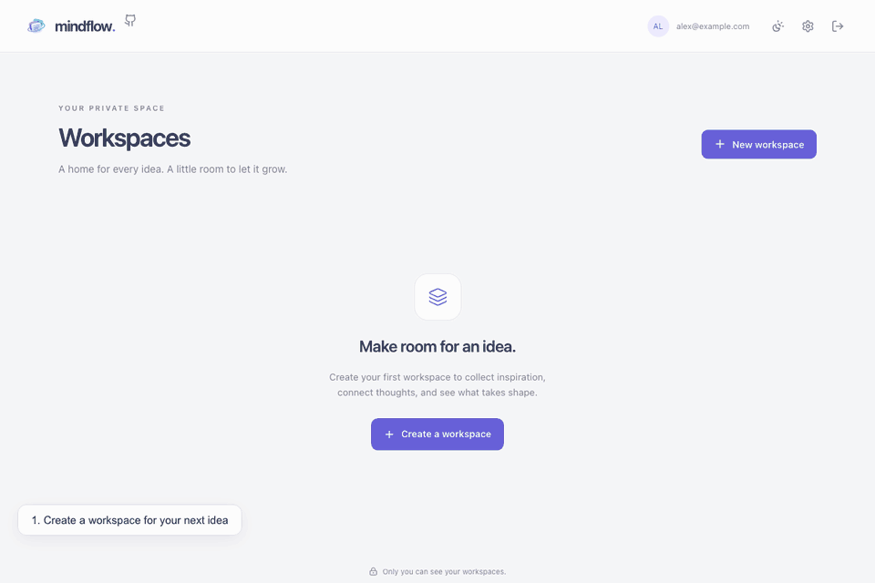

<p align="center">
  
</p>

<p align="center"><a href="https://github.com/Neokil/mindflow/releases/latest"></a> · <a href="https://github.com/Neokil/mindflow/releases/latest">Release notes</a></p>

<h1 align="center">mindflow</h1>

<p align="center">A little space for your thoughts.</p>

<p align="center">
  Latest unreleased build (main): <a href="https://github.com/Neokil/mindflow/actions/workflows/ci.yml"></a>
  <a href="https://github.com/Neokil/mindflow/wiki">Wiki</a> · <a href="https://github.com/Neokil/mindflow/issues">Report an issue</a>
</p>

mindflow is a minimal, self-hosted infinite canvas for images, shapes, text, and freehand drawing. Organize ideas in workspaces with tabbed pages, invite people you trust, and discuss details directly on the canvas. Workspaces are private by default.



## Installation

Run mindflow with Docker Compose:

```yaml
services:
  mindflow:
    image: neokil/mindflow:latest
    ports:
      - "127.0.0.1:8080:8080"
    volumes:
      - mindflow-data:/data
    read_only: true
    tmpfs:
      - /tmp:size=64m,mode=1777
    cap_drop:
      - ALL
    security_opt:
      - no-new-privileges:true
    restart: unless-stopped
    stop_grace_period: 30s
volumes:
  mindflow-data:
```

Save this as `compose.yaml`, then run:

```sh
docker compose up -d
docker compose logs mindflow
```

Route an HTTPS reverse proxy or Cloudflare Tunnel to the HTTP service on port **8080**. Open your public HTTPS URL, enter the one-time setup credential from the log, create the first administrator, and configure SMTP with TLS/STARTTLS for invitations and password recovery. If your tunnel runs in Docker, connect the containers through a private Docker network rather than the host's loopback binding.

All accounts, canvases, and images are stored in the `/data` volume. The runtime uses `scratch` and runs as UID/GID **10001**. Images are published only when a versioned GitHub release is published. `latest` follows stable releases; pin a version tag for reproducible deployments. Main-branch CI tests the next unreleased build without publishing an image.

For TrueNAS Apps, use [the installation guide](docs/user-docs/installation.md) and [Custom App YAML](deploy/truenas.yaml). See [operations](docs/user-docs/operations.md) for snapshots, restore, and application updates. Read the [security notes](docs/SECURITY.md) before exposing your instance.

## Features

- **Room for ideas:** infinite pan and cursor-centered zoom, tabbed pages, a dot grid, and optional snapping.
- **Create freely:** drag to size images, shapes, and text; draw with a mouse, finger, or Pencil. Add lists and checklists, highlight content, crop, rotate, group, duplicate, and arrange elements.
- **Reuse layouts:** save selections as workspace templates and lock groups to keep finished content in place.
- **Share deliberately:** invite-only accounts and private workspaces, with read-only, comment, or full access for selected users.
- **Discuss in context:** positioned comments, replies, avatars, and resolution controls.
- **Stay in control:** one writer per page, approval-based control requests, owner force control, and recovery of displaced unsaved work.
- **Keep your place:** workspace/page links, autosave, temporary disconnected editing, and a banner when a new build is available.
- **Read and annotate PDFs:** import pages as images on one canvas or separate pages, or keep a PDF with an in-app reader.
- **Take your work with you:** export workspaces or selected pages as editable `.mindflow` files, PDFs, or PNG images; import native files as new workspaces or append their pages.
- **Bring existing work:** import/export Butterfly notebooks, try experimental native Goodnotes conversion, and bulk-import a collection of files.
- **Capture a detail:** select a canvas region to download a PNG or copy an image to the clipboard.
- **Help shape mindflow:** private bug reports and feature requests with image attachments, discussion, unread-reply badges, administrator search, and release-linked fixes; opt-in product-update emails.
- **Make it yours:** light/dark appearance and a quiet interface for desktop Chrome/Firefox and iPad Safari.

Scroll to zoom. Cmd/Ctrl + drag or hold the middle mouse button to pan. Hold Shift while creating an element for equal width and height. On tablets, drag with one finger or Pencil and use two fingers to pan/pinch to zoom. The editor's keyboard button lists more controls.

Choose **Import workspace** on the workspace list to select one or several mindflow, Butterfly, Goodnotes, or PDF files. See [import, export, and migration](docs/user-docs/interoperability.md) for editability, experimental-format status, and conversion limits.

## License

mindflow is licensed under the [MIT License](LICENSE). Copyright © 2026 Simon Schulte. Third-party components retain their respective licenses; see [third-party notices](THIRD_PARTY_NOTICES.md).

## Development

Requires Go matching [go.mod](go.mod), Node.js **22.13+**, and npm. The container build pins its toolchain versions.

```sh
cd web && npm ci && cd ..
make frontend-build
make dev
```


Open **http://localhost:8080**. Development mode permits local HTTP; use production mode behind your HTTPS domain. For live frontend development, run `make frontend` in another terminal and open **http://localhost:5173**. Local data defaults to `data/mindflow.sqlite`; set `MINDFLOW_DATA` to change it.

```sh
make lint
make test
make audit
make test-e2e
make verify-container
```

Install browser binaries once with `cd web && npx playwright install chromium firefox webkit`. Container checks require Docker, Python 3, and OpenSSL. CI runs quality, security, browser, and container checks on pushes to `main`, pull requests, manual runs, and release verification.

Run `make generate` after editing SQL or migration packages and commit the generated files. See [project structure](docs/developer-docs/architecture.md), [data structures](docs/developer-docs/data-model.md), [canvas and saving](docs/developer-docs/canvas-and-sync.md), and the [API contract](api/openapi.yaml). `make upgrade` refreshes dependencies and pinned build references; see [upgrade instructions](docs/developer-docs/dependencies.md).

### Refresh the demo

```sh
make demo
```

This manually runs the [Playwright recording script](web/scripts/record-demo.mjs) against an isolated temporary instance, then writes `docs/media/workflow.gif`. It requires Python 3.11+; the command installs its pinned GIF encoder into `.cache/demo-venv`. Raw Playwright video stays under `.cache/demo/video/`. It never uses production accounts, data, or email delivery, and is not run automatically. See [recording details](docs/developer-docs/demo.md).
