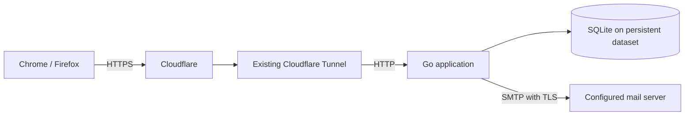

# mindflow — Technical architecture

Status: technical draft, 12 November 2026. Product scope is defined in [REQUIREMENTS.md](REQUIREMENTS.md). Interview decisions below are agreed; implementation details are proposed defaults to validate during implementation.

Related documents: [Canvas and synchronization](CANVAS_AND_SYNC.md), [Deployment and operations](DEPLOYMENT.md).

## 1. Agreed decisions

| Area | Decision |
| --- | --- |
| Backend | Go. |
| Frontend | React, TypeScript, and Vite. |
| Canvas | Evaluate Konva with react-konva in an early prototype before committing. |
| Storage | SQLite, including uploaded image originals and generated variants as BLOBs. |
| Deployment | One application container, installed using Compose-compatible YAML through TrueNAS Custom Apps. |
| Network | Application serves HTTP; the existing Cloudflare Tunnel provides public HTTPS. |
| Scale | Fewer than 10 users; initially target a few thousand elements and hundreds of images per page. |
| Editing | One active editor per page; other sessions are read-only and can explicitly take over. |
| Recovery | Preserve displaced unsaved edits in memory and offer saving them as a separate page. |
| Browser support | Current stable desktop Chrome and Firefox. |
| Backup | Managed by TrueNAS snapshots. |

## 2. System shape



The Go process serves the compiled frontend, a same-origin JSON API, protected image endpoints, and a server-sent event stream. It also runs bounded background work for image variants and email delivery. No Node.js runtime, separate frontend server, database server, Redis, or external object store is needed in production.

Run exactly one application instance against the database. This is a deliberate single-server architecture. Shared workspaces, horizontal scaling, and multi-writer collaboration are outside this release.

Use Go's `net/http` and `ServeMux` for routing, `database/sql` for database access, and embedded frontend assets. Method and path routing are supported by the standard library. [Go routing documentation](https://go.dev/blog/routing-enhancements)

Use explicit SQL and versioned migrations. Select a maintained SQLite driver and image-processing library during the prototype; record their versions and licenses before implementation depends on them. Pin toolchains and dependencies rather than using floating versions in release builds.

## 3. Domain packages and collaboration

Organize production code around individual business responsibilities. Each domain contains its models, policies and operations. Every database concern is inside that domain's `storage` subpackage: repository implementation, SQL queries, generated query code and Goose migrations. Domains that expose HTTP operations also own their route handlers. There is no shared domain repository, service, error, result or identifier package.

| Package | Owned responsibility |
| --- | --- |
| `account` | Accounts, password policy and hashing, roles, activation status, appearance and last-administrator rules. |
| `session` | Persisted sessions, secret verifiers, expiry, logout and revocation. |
| `authentication` | Sign-in orchestration and request/session/CSRF/administrator middleware, using accounts and sessions. |
| `invitation` | Invite-only account creation, invitation links, resending and activation. |
| `passwordreset` | Forgotten-password requests, administrator resets and one-time reset redemption. |
| `email` | SMTP transport, queued email, retries, cancellation and test delivery. |
| `installation` | First-run setup, public URL and SMTP settings. Its storage package owns installation records and their migrations. |
| `workspace` | Workspace metadata, recency and coordination of its page lifecycle. |
| `page` | Page metadata, ordering, creation, duplication, deletion and recovery copies. |
| `canvas` | Document content, element validation, copying element identities, image references and idempotent saves. |
| `editor` | Single-editor leases, renewal, takeover and stale-writer fencing. |
| `image` | Original images, preview sizes, protected image access and variant processing. |
| `notification` | Owner-scoped realtime events, subscribers and SSE lifecycle. |

The product root, `internal/mindflow`, composes these domains and supplies common HTTP mechanics. It installs middleware, encodes responses, enforces origins and request limits, serves the frontend, starts workers and coordinates shutdown. It contains no account, workspace, canvas, email or image controllers. Its `storage` subpackage owns the SQLite connection, integrity checks, cross-domain storage assembly and Goose coordination. `internal/architecture` contains only tests.

A stored domain has this layout, with files named for its own concepts:

```text
internal/<domain>/
  model/service/policy files     Domain types and behavior
  http.go                       Domain-owned controllers, where applicable
  storage/
    repository.go               Domain storage implementation and transaction binding
    queries/queries.sql         Explicit, named SQL
    queries.sql.go              sqlc-generated queries in package storage
    sqlc_db.go                  Generated SQL binding
    migrations/
      migrations.go             Embedded files and explicit domain dependencies
      00001_initial.sql         Independent Goose migration sequence
  *_test.go                     Focused domain tests
```

Collaborations are ordinary method calls with explicit constructor dependencies or small interfaces declared by the consuming domain. Examples:

- Authentication asks the account domain to verify credentials, then asks sessions to issue a session. Request authentication verifies a session and reloads the account's current status.
- Invitations create an invited account and queue mail through their respective domains. Redemption asks accounts to change the password; account credential changes invoke a revocation port that coordinates sessions, invitations, password resets and queued mail in the same transaction.
- Workspace creation asks pages to create a blank page. Workspace duplication asks pages to copy their metadata and canvas content. Image removal goes through the image domain.
- Canvas saving asks editor control to validate the lease inside the save transaction and asks images to check ownership. A workspace-activity port records parent recency without introducing a canvas/workspace import cycle.
- Email obtains saved SMTP configuration through an installation interface and checks credential-link validity through invitation/reset interfaces before delivering queued mail.

Repositories keep their SQLite handles private. Domain services receive their own typed storage repository; services and controllers do not import `database/sql`. Collaborating operations receive an explicit storage transaction handle, preserving atomic ownership checks, token consumption, saves, references and credential revocation. A domain's storage repository binds generated queries to that transaction with `Within`. Storage adapters translate SQL-specific nullable values and row counts before returning policy data. Contexts propagate through the complete operation.

Existing `account_tokens` rows remain partitioned by invitation/reset purpose, and `jobs` rows by email/preview kind. Every mutating query for those shared tables contains its domain's purpose/kind guard. Pages own metadata and lifecycle; canvas owns the document/revision fields stored on page rows. Read joins support ownership checks and projections. This preserves existing content while moving persistence into domain storage packages.

### Domain migrations

Goose 3.30.0 handles all schema changes. Each `internal/<domain>/storage/migrations` package embeds its own numbered SQL files and declares prerequisite domain names. The product storage coordinator creates one Goose provider per package with its own history table (`goose_account_version`, `goose_invitation_version`, `goose_canvas_version`, and so on). Repeated migration numbers across domains are valid. A canvas upgrade advances only canvas history.

`cmd/genmigrations` scans domain storage directories and generates the imports and catalog under `internal/mindflow/storage`. Discovery happens at build time because Go packages must be linked into the binary. Adding a migration file to an existing package is picked up by its embedded filesystem; adding a migration package requires `make generate`, without editing a central import list by hand. `go generate ./internal/mindflow/storage` also regenerates the catalog. CI and Docker builds reject stale catalogs.

The `migrate` command applies all pending domain migrations in dependency order. Normal server startup uses the same coordinator before serving requests. Providers have independent history tables and disable Goose's global Go-migration registry, preventing migration-version collisions. Each SQL migration and its history record are transactional through Goose. Previously completed domain migrations remain applied if a later domain fails; retry resumes the pending work. Missing dependencies, cycles and database versions newer than this binary are rejected before pending domain changes are applied.

The first Goose migrations adopt the existing version-2 tables without changing their content. A preflight check rejects an unsupported legacy version. The installation domain then retires the old `schema_migrations` table through a Goose migration. Snapshot restore remains the supported release rollback procedure. The application exposes migration up only, keeping rollback coordinated with the matching binary and snapshot.

`sqlc.yaml` reads the Goose migration directories as its schema source. Generated code is committed under each domain's `storage` package. There is no second schema definition or custom DDL migration runner.

Boundary tests verify that former horizontal packages are absent, stored domains own migrations and queries, database dependencies stay inside storage, domain controllers do not construct queries, and SQL writes remain with their owner or guarded row partition. Migration integration tests cover independent versions, repeated runs, failure rollback/retry, legacy-data preservation, version refusal and invalid dependency graphs.

Use explicit constructors, ordinary Go methods, local interfaces and SQL transactions. Avoid generic command dispatch, reflection-based wiring, shared repository containers and additional runtime frameworks.

## 4. Frontend architecture

React manages application navigation, forms, tabs, toolbars, settings, and editor state. Vite builds the frontend for embedding in the Go release. This is a browser-rendered app; server-side rendering is unnecessary for its private editor flows. [React setup documentation](https://react.dev/learn/build-a-react-app-from-scratch)

The frontend is organized by feature. `accounts` contains authentication, administration and shared SMTP fields; `workspaces` contains the dashboard, page tabs and naming dialogs. The editor separates the document/gesture controller, Konva scene, element rendering, HTML text editor, toolbar, selection inspector, help and keyboard shortcuts. Shared geometry and the save-session state machine remain independent modules.

The application owns the authenticated event stream and passes typed events and callbacks through props. Reauthentication is an explicit callback; there is no global custom-event bus. Hooks declare their dependencies, and TypeScript rejects unused locals and parameters.

Keep three categories of state separate:

- Server metadata: accounts, workspace/page lists, permissions, revisions.
- In-memory document state: page content, undo/redo history, pending saves, pending images, recovery copies.
- Transient interaction state: cursor, lasso, active tool, drag/resize preview, camera.

Do not drive every pointer movement through a full React document render. Apply transient canvas updates during a gesture and commit one logical document change when it completes. Wrap the renderer behind an adapter so the persisted model does not depend on Konva serialization.

Use HTML controls for account screens, toolbars, and text entry. Text editing overlays an HTML editor on the canvas element; formatting applies to the whole element, so a full rich-text framework is unnecessary.

A prototype must prove freehand lasso geometry, rotated transforms, image corner/side resizing, text editing/resizing, and acceptable performance before the renderer choice is finalized. Konva provides React bindings and transform controls, but the product-specific interactions remain our responsibility. [Konva React documentation](https://konvajs.org/docs/react/index.html), [transform controls](https://konvajs.org/docs/react/Transformer.html)

## 5. SQLite model

All durable application state is in SQLite, including settings, media, jobs, and sessions. There are no required image directories or external application secrets files. Temporary processing buffers are disposable and must not become necessary for restore.

This is a logical schema; migration SQL will define exact column types, constraints, and indexes.

| Table | Main fields / purpose |
| --- | --- |
| `app_settings` | Singleton initialization state, public URL, SMTP configuration, settings version. |
| `users` | ID, normalized unique email, password hash (nullable while invited), role, status, timestamps. |
| `sessions` | ID, user ID, hashed random verifier, CSRF secret, creation/absolute expiry, revocation. |
| `account_tokens` | User ID, purpose (invite/reset), token hash, expiry, consumed timestamp. |
| `workspaces` | ID, owner ID, name, metadata revision, timestamps. |
| `pages` | ID, workspace ID, name, sort position, content revision, schema version, document JSON, timestamps. |
| `assets` | ID, owner ID, original BLOB, verified MIME type, dimensions, byte count, digest, created timestamp. |
| `asset_variants` | Asset ID, target dimensions, encoder version, MIME type, BLOB, unique variant key. |
| `page_assets` | Page/asset links, including assets retained for the page's undo safety. |
| `page_leases` | Page ID, holder session/client ID, increasing epoch, lease expiry. |
| `save_receipts` | Page/client/mutation ID, request digest, committed revision, acknowledgment expiry. |
| `jobs` | Type, deduplication key, payload, status, attempts, next attempt time. |
| `goose_<domain>_version` | Independent applied Goose versions for each domain; replaces the legacy `schema_migrations` table. |

Use opaque random IDs generated by the server for entities; clients generate collision-resistant IDs for new elements and mutation attempts. Store timestamps in UTC. Email normalization must be consistent across invitations, login, and resets; do not apply provider-specific dot or plus-address rewriting.

### Documents and assets

Store one versioned JSON document per page, rather than relational rows for each drawing point or renderer-specific scene JSON. The page revision is maintained separately by the server. Updates atomically replace the validated document and its reference metadata. This is intentionally simple for a small single-editor deployment; large-page performance must be measured before release.

Original image bytes and variant bytes live separately from page JSON. Opening a page never loads every original BLOB as part of its document response. Image elements refer to asset IDs.

Maintain owner consistency between workspace, page, and every referenced asset in application transactions. The server rejects a document containing another user's asset even if the ID is known. Foreign keys enforce deletion relationships, and indexes cover owner lookups, page ordering, asset links, token lookup, expiry, and job scheduling.

### Asset retention and duplication

Copies receive new workspace/page/element IDs. Immutable asset bytes may be shared between pages belonging to the same user; references are independent, so deleting the original page cannot break a copy. Never deduplicate images across users.

Proposed first-release storage tradeoff: once an asset is committed to a page, retain its `page_assets` link until that page is deleted, even after the image is removed from its current document. This makes session undo and recovery safe without reconstructing deleted originals. The consequence is that removing an image alone does not immediately reclaim database space. This retains no old page documents and does not add user-visible version history.

Delete unused assets when their last retaining page is deleted. Clean up uploads never committed to a page after 24 hours; clients with pending uploads handle expiration by reuploading their in-memory originals. Jobs and variants follow the asset's lifecycle. Any later storage-reclamation feature must preserve active undo/recovery before removing retained assets.

### Deletion

User deletion is one transaction removing the user, workspaces, pages, asset originals/variants, sessions, tokens, leases, receipts, and associated jobs. Invalidate live event streams and workers as part of deletion; workers must recheck ownership/existence before committing results.

Workspace and page deletion similarly remove their children and links, while preserving assets still retained elsewhere. No application trash or soft-deleted content is included. File size may not shrink immediately after SQL deletion; space reclamation is operationally separate. Existing TrueNAS snapshots retain their historical contents until their retention policy removes them.

## 6. HTTP API outline

Use `/api/v1` with JSON requests/responses, except multipart uploads, image bytes, and SSE. Detailed schemas will be maintained in OpenAPI during implementation.

| Area | Routes / operations |
| --- | --- |
| Setup | `GET /setup/status`, `POST /setup/complete`. |
| Authentication | `POST /auth/login`, `POST /auth/logout`, `GET /auth/me`. |
| Recovery | `POST /auth/forgot-password`, `POST /auth/reset-password`, `POST /auth/accept-invite`. |
| Admin users | `GET/POST /admin/users`, status/role updates, delete, resend invite, send reset. |
| Admin settings | Read/update `/admin/settings`, `POST /admin/settings/test-email`. Never return SMTP password. |
| Workspaces | List/create, get/update/delete by ID, explicit duplicate operation. |
| Pages | List/create within workspace, get/update metadata/delete, duplicate, reorder. |
| Document | `GET/PUT /pages/{id}/document`; revision and mutation identity required on PUT. |
| Editor control | Acquire, renew, release, and explicit takeover under `/pages/{id}/lease`. |
| Assets | Upload, owner-scoped metadata, protected original/variant retrieval. |
| Recovery copy | `POST /pages/{id}/recovery-copy`, or a new page in another owned workspace if the source is gone. |
| Events | `GET /events`, scoped to the authenticated user's sessions/content. |

No admin route accepts a target user ID to retrieve that user's workspace content. Entity lookups outside the caller's ownership return `404`. API errors include a stable code and request ID; useful codes include `validation_failed`, `revision_conflict`, `lease_lost`, `session_expired`, and `asset_missing`.

Use `401` for missing/expired authentication, `403` for missing administrative privilege, `409` for save/lease conflicts, `413` for exceeded limits, and `429` for rate limits. Structural changes such as rename, reorder, duplicate, and delete use metadata revision checks so stale tabs do not silently overwrite each other.

## 7. Authentication and authorization

### Passwords and sessions

Use Argon2id with per-password random salts, stored parameters, and upgrade-on-login support. Start with at least the OWASP baseline of 19 MiB memory, two iterations, one lane; benchmark and raise cost where practical. Passwords are never recoverable from the database. [OWASP password storage guidance](https://cheatsheetseries.owasp.org/cheatsheets/Password_Storage_Cheat_Sheet.html)

Use opaque random server-side sessions instead of browser-stored JWTs. Store only a hash of the session verifier. Session cookies are `HttpOnly`, `Secure`, `SameSite=Lax`, host-only, and path `/` in public deployment. Sessions expire absolutely after 30 days; logout, password reset, deactivation, and deletion revoke them earlier. Validate active account/session state on every API and asset request. Expiration also closes event streams. [OWASP session guidance](https://cheatsheetseries.owasp.org/cheatsheets/Session_Management_Cheat_Sheet.html)

Proposed password policy: minimum 15 characters, maximum at least 128 characters, Unicode and password-manager paste allowed, no forced composition rules. Bound input length before hashing. Apply login/reset/setup rate limits and concurrent hashing limits.

### Invitations and resets

- Invitations expire after seven days; reset links after one hour.
- Generate random tokens, store their hashes, and consume them atomically once.
- Resending an invite/reset invalidates prior outstanding tokens for that purpose.
- Forgot-password responses do not reveal whether an address exists.
- Email links use the configured public URL, never an untrusted request host.
- Email link GET requests show a form; only explicit submission consumes a token.
- Reset completion revokes existing sessions and does not automatically log in the user.

Keep tokens out of request logs, referrers, analytics, and long-lived browser storage. Use URL fragments for email tokens where practical and clear them after loading into memory. Invitation emails must not expose administrator-only actions.

### Setup and administration

First-run setup requires a one-time bootstrap credential made available to the server operator on initial startup. Submit it in the setup request body, not the URL. This prevents public visitors from claiming a newly exposed instance. Setup consumes the credential and commits the first administrator, SMTP settings, public URL, and initialization flag atomically. Setup status reveals only initialization state. Exact operator credential delivery will be documented with implementation.

An SMTP test is available during setup; configuration errors must be visible and settings must be correctable afterward. Administrator account invitation, deactivation/reactivation, deletion, and role assignment are confined to user-management operations. Enforce the last-active-administrator guard transactionally, including self-deactivation, self-deletion, and demotion.

SMTP credentials are durable database settings, readable by the application but never returned by the API or included in logs. This draft relies on private dataset permissions and infrastructure encryption at rest rather than adding a separately backed-up encryption key.

### Request protection

Use session-bound CSRF tokens and origin checks for mutations; verify setup/login origins too. Do not enable cross-origin API access. Apply a restrictive content security policy, render names/text as text rather than HTML, and disallow active image formats such as SVG uploads. Authenticated responses must bypass Cloudflare caching; API, event, and image responses use `Cache-Control: no-store`. Fingerprinted public frontend assets can be cached.

Only configured proxy peers may supply trusted forwarding headers. Secure cookies and allowed origin are determined from deployment configuration, not arbitrary `X-Forwarded-*` headers. API rate limiting should fall back to the direct peer if no trusted client-address source is configured.

## 8. Validation, limits, and testing

Initial configurable defaults, to validate with measurements:

| Limit | Proposed starting value |
| --- | --- |
| Upload | 20 MiB per image, explained as 20 MB in UI. |
| Decoded image | 40 million pixels and 16,384 pixels per dimension. |
| Page document | 16 MiB uncompressed JSON. |
| Page element count | 10,000, with performance testing centered on 3,000. |
| Drawn points | 20,000 per stroke; simplify input without visible discontinuities. |
| Image worker concurrency | One job initially. |

Reject non-finite numbers, oversized coordinates, invalid transforms, cyclic groups, missing assets, unsupported element/document versions, malformed colors/text, and excessive nesting. Reject an over-limit edit visibly without pretending it saved. The UI should warn before known limits are exceeded.

Use Go service/integration tests against real temporary SQLite databases, TypeScript tests for pure geometry/document/history code, and browser tests in Chrome and Firefox. Prioritize ownership isolation including assets, user cascade deletion, atomic setup, one-use tokens, last-admin protection, lease fencing, idempotent saves, offline recovery, duplication, and background-job races. Test public HTTPS configuration with an HTTP origin.

Prototype exit criteria and synchronization tests are specified in [CANVAS_AND_SYNC.md](CANVAS_AND_SYNC.md). The implementation, API contract, and container manifests are now in this repository. See [RUNNING.md](RUNNING.md) and [IMPLEMENTATION.md](IMPLEMENTATION.md) for actual configuration and validation.

## Implementation notes

Konva/react-konva was adopted after browser validation. The current database connection is serialized for both reads and writes; a read pool remains an optimization option. Image processing is bounded, decoded images are shared in memory with a 64 MiB/64-entry cache budget, and all authenticated content remains uncached by HTTP intermediaries. Actual dependency versions and validation limits are recorded in [IMPLEMENTATION.md](IMPLEMENTATION.md).
