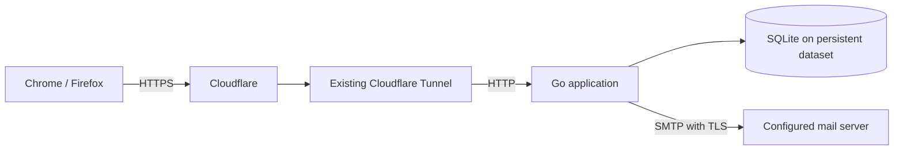

# mindflow — Technical architecture

Status: technical draft, 12 November 2026. Product scope is defined in [REQUIREMENTS.md](REQUIREMENTS.md). Interview decisions below are agreed; implementation details are proposed defaults to validate during implementation.

Related documents: [Canvas and synchronization](CANVAS_AND_SYNC.md), [Deployment and operations](DEPLOYMENT.md).

## 1. Agreed decisions

| Area | Decision |
| --- | --- |
| Backend | Go. |
| Frontend | React, TypeScript, and Vite. |
| Canvas | Evaluate Konva with react-konva in an early prototype before committing. |
| Storage | SQLite, including uploaded image originals and generated variants as BLOBs. |
| Deployment | One application container, installed using Compose-compatible YAML through TrueNAS Custom Apps. |
| Network | Application serves HTTP; the existing Cloudflare Tunnel provides public HTTPS. |
| Scale | Fewer than 10 users; initially target a few thousand elements and hundreds of images per page. |
| Editing | One active editor per page; other sessions are read-only and can explicitly take over. |
| Recovery | Preserve displaced unsaved edits in memory and offer saving them as a separate page. |
| Browser support | Current stable desktop Chrome and Firefox. |
| Backup | Managed by TrueNAS snapshots. |

## 2. System shape



The Go process serves the compiled frontend, a same-origin JSON API, protected image endpoints, and a server-sent event stream. It also runs bounded background work for image variants and email delivery. No Node.js runtime, separate frontend server, database server, Redis, or external object store is needed in production.

Run exactly one application instance against the database. This is a deliberate single-server architecture. Workspace sharing and comments are supported with one writer per page. Horizontal scaling and simultaneous canvas writers are outside this release.

Use Go's `net/http` and `ServeMux` for routing, `database/sql` for database access, and embedded frontend assets. Method and path routing are supported by the standard library. [Go routing documentation](https://go.dev/blog/routing-enhancements)

Use explicit SQL and versioned migrations. Select a maintained SQLite driver and image-processing library during the prototype; record their versions and licenses before implementation depends on them. Pin toolchains and dependencies rather than using floating versions in release builds.

## 3. Domain packages and collaboration

The top-level domains are `account`, `workspace`, `email` and `installation`. Each owns its complete data model under one `storage` package: schema migrations, SQL queries, sqlc bindings and repository code. Subdomains organize behavior and controllers, and use their top-level domain's storage. Subdomains do not define schemas or repositories of their own.

| Domain / subdomain | Responsibility |
| --- | --- |
| `account` | Accounts, password policy, roles, status, appearance and account lifecycle. Owns users, sessions and credential tokens. |
| `account/session` | Session creation, verification, expiry and logout. |
| `account/authentication` | Sign-in and request/session/CSRF/administrator middleware. |
| `account/invitation` | Invitations, resending and activation. |
| `account/passwordreset` | Forgotten-password requests, administrator resets and redemption. |
| `workspace` | Workspace lifecycle. Owns workspace, page, canvas, editor and image data. |
| `workspace/page` | Page ordering, creation, duplication, deletion and recovery copies. |
| `workspace/page/canvas` | Documents, validation, image references and idempotent saving. |
| `workspace/sharing` | Owner-managed membership roles, account lookup through an interface and targeted lease invalidation. |
| `workspace/page/comment` | Positioned discussion threads, replies and creator/owner management. |
| `workspace/page/editor` | Editor leases, takeover and stale-writer fencing. |
| `workspace/image` | Originals, variants, protected delivery and preview jobs. |
| `email` | SMTP delivery, its own mail queue, retries, cancellation and delivery status. |
| `installation` | First-run setup, public URL and SMTP settings. |
| `notification` | Owner-scoped realtime events and SSE; no persisted schema. |

Foreign keys stay inside a top-level domain. Account sessions/tokens reference users; workspace pages, image references, leases and preview jobs reference other workspace-owned tables. Workspace ownership and editor session IDs are opaque references to the account domain, without cross-domain FKs. Ownership or explicit membership is checked against the authenticated account on requests. Authentication validates the account and session before invoking workspace operations.

No domain's SQL reads or writes another domain's tables. sqlc compiles each domain's queries against only its own migration directory. In particular, account listings obtain mail errors through the `CredentialMail` interface. Email owns `mail_jobs`; workspace owns `image_jobs`. No job table is shared between these domains. Account invitation/reset tokens share an account-owned table distinguished by purpose.

```text
internal/account/
  accounts.go, password.go, service.go, http.go
  authentication/
  session/
  invitation/
  passwordreset/
  storage/
    repository.go
    queries/queries.sql
    queries.sql.go, sqlc_db.go, sqlc_models.go
    migrations/migrations.go, migrations/00001_initial.sql
internal/workspace/
  workspaces.go, service.go, http.go
  sharing/
  page/
    comment/
    canvas/
    editor/
  image/
  storage/                      Complete workspace schema and queries
internal/email/storage/          Independent mail schema and queries
internal/installation/storage/   Independent configuration schema and queries
```

Collaborations use ordinary method calls, small interfaces and explicit constructors. The product root, `internal/mindflow`, composes services and supplies common HTTP mechanics. Its `storage` subpackage owns connection lifecycle, Goose coordination and integrity/restore maintenance. It does not define domain tables or SQL queries over them.

Cross-domain deletion is explicit and synchronous. Account deletion asks the `UserContent` collaborator to remove that owner's workspaces and images, asks `CredentialMail` to remove queued mail, then deletes the account. Account-owned and workspace-owned dependents cascade internally. The whole operation shares one SQLite transaction: failure rolls everything back. Password changes revoke account credentials and queued mail in one transaction too. Sharing a transaction does not grant a domain access to another domain's tables.

Domain storage repositories keep connection handles private and expose transaction binding through `Within`. Services and controllers do not import `database/sql`. Storage adapters translate nullable values and affected-row counts. Contexts propagate through all operations. Canvas saving coordinates its sibling editor/image behavior and workspace activity within the workspace transaction.

### Domain migrations

Goose 3.30.0 handles schema changes. Four embedded migration packages own independent histories: `goose_account_version`, `goose_workspace_version`, `goose_email_version` and `goose_installation_version`. Each schema can migrate on an otherwise empty database, including down/up in isolation. There are no cross-domain migration dependencies or dependency graph to maintain.

`cmd/genmigrations` discovers migration packages and generates the catalog under `internal/mindflow/storage`. Discovery happens at build time because Go packages must be linked. Add migration files to the embedded filesystem; when adding a top-level migration package, run `make generate` to link it without editing a central import list. `go generate ./internal/mindflow/storage` also regenerates the catalog. CI and Docker reject stale catalogs.

`mindflow migrate` and normal startup use the same runner. Providers disable Goose's global migration registry to avoid version collisions. Each SQL migration and history entry is transactional. A later domain's failure leaves earlier successful domains applied; retry resumes pending work. All providers are checked for unsupported newer versions before pending migrations run.

The initial development migrations have been replaced with this layout by agreement. Databases from the previous layout are not supported for upgrade; start with a fresh development database. The application does not delete or reset an existing database automatically. Future released migrations must be appended rather than rewriting applied files. Release rollback uses a matching image and snapshot; the CLI exposes migration up only.

Boundary tests scan nested packages for misplaced storage and foreign storage imports, and reject SQL reads, writes and foreign keys crossing top-level ownership. Integration tests cover isolated up/down/up, independent version upgrades, idempotency, migration rollback/retry, version refusal and atomic account deletion failure/retry. Use explicit constructors and SQL transactions; avoid generic dispatch and reflection-based wiring.

## 4. Frontend architecture

React manages application navigation, forms, tabs, toolbars, settings, and editor state. Vite builds the frontend for embedding in the Go release. This is a browser-rendered app; server-side rendering is unnecessary for its private editor flows. [React setup documentation](https://react.dev/learn/build-a-react-app-from-scratch)

The frontend is organized by feature. `accounts` contains authentication, administration and shared SMTP fields; `workspaces` contains the dashboard, page tabs and naming dialogs. The editor separates the document/gesture controller, Konva scene, element rendering, HTML text editor, toolbar, selection inspector, help and keyboard shortcuts. Shared geometry and the save-session state machine remain independent modules.

The application owns the authenticated event stream and passes typed events and callbacks through props. Reauthentication is an explicit callback; there is no global custom-event bus. Hooks declare their dependencies, and TypeScript rejects unused locals and parameters.

Keep three categories of state separate:

- Server metadata: accounts, workspace/page lists, permissions, revisions.
- In-memory document state: page content, undo/redo history, pending saves, pending images, recovery copies.
- Transient interaction state: cursor, lasso, active tool, drag/resize preview, camera.

Do not drive every pointer movement through a full React document render. Apply transient canvas updates during a gesture and commit one logical document change when it completes. Wrap the renderer behind an adapter so the persisted model does not depend on Konva serialization.

Use HTML controls for account screens, toolbars, and text entry. Text editing overlays an HTML editor on the canvas element; formatting applies to the whole element, so a full rich-text framework is unnecessary.

A prototype must prove freehand lasso geometry, rotated transforms, image corner/side resizing, text editing/resizing, and acceptable performance before the renderer choice is finalized. Konva provides React bindings and transform controls, but the product-specific interactions remain our responsibility. [Konva React documentation](https://konvajs.org/docs/react/index.html), [transform controls](https://konvajs.org/docs/react/Transformer.html)

## 5. SQLite model

All durable application state is in SQLite, including settings, media, jobs, and sessions. There are no required image directories or external application secrets files. Temporary processing buffers are disposable and must not become necessary for restore.

This is a logical schema; migration SQL will define exact column types, constraints, and indexes.

| Table | Main fields / purpose |
| --- | --- |
| `app_settings` | Singleton initialization state, public URL, SMTP configuration, settings version. |
| `users` | ID, normalized unique email, password hash (nullable while invited), role, status, timestamps. |
| `sessions` | ID, user ID, hashed random verifier, CSRF secret, creation/absolute expiry, revocation. |
| `account_tokens` | User ID, purpose (invite/reset), token hash, expiry, consumed timestamp. |
| `workspaces` | ID, owner ID, name, metadata revision, timestamps. |
| `pages` | ID, workspace ID, name, sort position, content revision, schema version, document JSON, timestamps. |
| `assets` | ID, owner ID, original BLOB, verified MIME type, dimensions, byte count, digest, created timestamp. |
| `asset_variants` | Asset ID, target dimensions, encoder version, MIME type, BLOB, unique variant key. |
| `page_assets` | Page/asset links, including assets retained for the page's undo safety. |
| `page_leases` | Page ID, holder session/client ID, increasing epoch, lease expiry. |
| `save_receipts` | Page/client/mutation ID, request digest, committed revision, acknowledgment expiry. |
| `mail_jobs` | Email-owned delivery payload, opaque account correlation ID, retries and delivery errors. |
| `image_jobs` | Workspace-owned asset reference, preview payload, deduplication and retries. |
| `goose_<domain>_version` | Independent applied Goose versions for each top-level stored domain. |

Use opaque random IDs generated by the server for entities; clients generate collision-resistant IDs for new elements and mutation attempts. Store timestamps in UTC. Email normalization must be consistent across invitations, login, and resets; do not apply provider-specific dot or plus-address rewriting.

### Documents and assets

Store one versioned JSON document per page, rather than relational rows for each drawing point or renderer-specific scene JSON. The page revision is maintained separately by the server. Updates atomically replace the validated document and its reference metadata. This is intentionally simple for a small single-editor deployment; large-page performance must be measured before release.

Original image bytes and variant bytes live separately from page JSON. Opening a page never loads every original BLOB as part of its document response. Image elements refer to asset IDs.

Maintain owner consistency between workspace, page, and every referenced asset in application transactions. The server rejects a document containing another user's asset even if the ID is known. Foreign keys enforce deletion relationships, and indexes cover owner lookups, page ordering, asset links, token lookup, expiry, and job scheduling.

### Asset retention and duplication

Copies receive new workspace/page/element IDs. Immutable asset bytes may be shared between pages belonging to the same user; references are independent, so deleting the original page cannot break a copy. Never deduplicate images across users.

Proposed first-release storage tradeoff: once an asset is committed to a page, retain its `page_assets` link until that page is deleted, even after the image is removed from its current document. This makes session undo and recovery safe without reconstructing deleted originals. The consequence is that removing an image alone does not immediately reclaim database space. This retains no old page documents and does not add user-visible version history.

Delete unused assets when their last retaining page is deleted. Clean up uploads never committed to a page after 24 hours; clients with pending uploads handle expiration by reuploading their in-memory originals. Jobs and variants follow the asset's lifecycle. Any later storage-reclamation feature must preserve active undo/recovery before removing retained assets.

### Deletion

User deletion is one transaction removing the user, workspaces, pages, asset originals/variants, sessions, tokens, leases, receipts, and associated jobs. Invalidate live event streams and workers as part of deletion; workers must recheck ownership/existence before committing results.

Workspace and page deletion similarly remove their children and links, while preserving assets still retained elsewhere. No application trash or soft-deleted content is included. File size may not shrink immediately after SQL deletion; space reclamation is operationally separate. Existing TrueNAS snapshots retain their historical contents until their retention policy removes them.

## 6. HTTP API outline

Use `/api/v1` with JSON requests/responses, except multipart uploads, image bytes, and SSE. Detailed schemas will be maintained in OpenAPI during implementation.

| Area | Routes / operations |
| --- | --- |
| Setup | `GET /setup/status`, `POST /setup/complete`. |
| Authentication | `POST /auth/login`, `POST /auth/logout`, `GET /auth/me`. |
| Recovery | `POST /auth/forgot-password`, `POST /auth/reset-password`, `POST /auth/accept-invite`. |
| Admin users | `GET/POST /admin/users`, status/role updates, delete, resend invite, send reset. |
| Admin settings | Read/update `/admin/settings`, `POST /admin/settings/test-email`. Never return SMTP password. |
| Workspaces | List/create, get/update/delete by ID, explicit duplicate operation. |
| Pages | List/create within workspace, get/update metadata/delete, duplicate, reorder. |
| Document | `GET/PUT /pages/{id}/document`; revision and mutation identity required on PUT. |
| Editor control | Acquire, renew, release, and explicit takeover under `/pages/{id}/lease`. |
| Assets | Workspace-scoped upload, membership-checked metadata and original/variant retrieval. |
| Sharing | Owner-only list/upsert/remove under `/workspaces/{id}/members`. |
| Comments | Read/create under `/pages/{id}/comments`; replies, resolve/reopen and delete under `/comments/{id}`. |
| Recovery copy | `POST /pages/{id}/recovery-copy`, or a new page in another owned workspace if the source is gone. |
| Events | `GET /events`, scoped to the authenticated user's sessions/content. |

No admin route accepts a target user ID to retrieve that user's workspace content. Entity lookups outside the caller's ownership return `404`. API errors include a stable code and request ID; useful codes include `validation_failed`, `revision_conflict`, `lease_lost`, `session_expired`, and `asset_missing`.

Use `401` for missing/expired authentication, `403` for missing administrative privilege, `409` for save/lease conflicts, `413` for exceeded limits, and `429` for rate limits. Structural changes such as rename, reorder, duplicate, and delete use metadata revision checks so stale tabs do not silently overwrite each other.

## 7. Authentication and authorization

### Passwords and sessions

Use Argon2id with per-password random salts, stored parameters, and upgrade-on-login support. Start with at least the OWASP baseline of 19 MiB memory, two iterations, one lane; benchmark and raise cost where practical. Passwords are never recoverable from the database. [OWASP password storage guidance](https://cheatsheetseries.owasp.org/cheatsheets/Password_Storage_Cheat_Sheet.html)

Use opaque random server-side sessions instead of browser-stored JWTs. Store only a hash of the session verifier. Session cookies are `HttpOnly`, `Secure`, `SameSite=Lax`, host-only, and path `/` in public deployment. Sessions expire absolutely after 30 days; logout, password reset, deactivation, and deletion revoke them earlier. Validate active account/session state on every API and asset request. Expiration also closes event streams. [OWASP session guidance](https://cheatsheetseries.owasp.org/cheatsheets/Session_Management_Cheat_Sheet.html)

Proposed password policy: minimum 15 characters, maximum at least 128 characters, Unicode and password-manager paste allowed, no forced composition rules. Bound input length before hashing. Apply login/reset/setup rate limits and concurrent hashing limits.

### Invitations and resets

- Invitations expire after seven days; reset links after one hour.
- Generate random tokens, store their hashes, and consume them atomically once.
- Resending an invite/reset invalidates prior outstanding tokens for that purpose.
- Forgot-password responses do not reveal whether an address exists.
- Email links use the configured public URL, never an untrusted request host.
- Email link GET requests show a form; only explicit submission consumes a token.
- Reset completion revokes existing sessions and does not automatically log in the user.

Keep tokens out of request logs, referrers, analytics, and long-lived browser storage. Use URL fragments for email tokens where practical and clear them after loading into memory. Invitation emails must not expose administrator-only actions.

### Setup and administration

First-run setup requires a one-time bootstrap credential made available to the server operator on initial startup. Submit it in the setup request body, not the URL. This prevents public visitors from claiming a newly exposed instance. Setup consumes the credential and commits the first administrator, SMTP settings, public URL, and initialization flag atomically. Setup status reveals only initialization state. Exact operator credential delivery will be documented with implementation.

An SMTP test is available during setup; configuration errors must be visible and settings must be correctable afterward. Administrator account invitation, deactivation/reactivation, deletion, and role assignment are confined to user-management operations. Enforce the last-active-administrator guard transactionally, including self-deactivation, self-deletion, and demotion.

SMTP credentials are durable database settings, readable by the application but never returned by the API or included in logs. This draft relies on private dataset permissions and infrastructure encryption at rest rather than adding a separately backed-up encryption key.

### Request protection

Use session-bound CSRF tokens and origin checks for mutations; verify setup/login origins too. Do not enable cross-origin API access. Apply a restrictive content security policy, render names/text as text rather than HTML, and disallow active image formats such as SVG uploads. Authenticated responses must bypass Cloudflare caching; API, event, and image responses use `Cache-Control: no-store`. Fingerprinted public frontend assets can be cached.

Only configured proxy peers may supply trusted forwarding headers. Secure cookies and allowed origin are determined from deployment configuration, not arbitrary `X-Forwarded-*` headers. API rate limiting should fall back to the direct peer if no trusted client-address source is configured.

## 8. Validation, limits, and testing

Initial configurable defaults, to validate with measurements:

| Limit | Proposed starting value |
| --- | --- |
| Upload | 20 MiB per image, explained as 20 MB in UI. |
| Decoded image | 40 million pixels and 16,384 pixels per dimension. |
| Page document | 16 MiB uncompressed JSON. |
| Page element count | 10,000, with performance testing centered on 3,000. |
| Drawn points | 20,000 per stroke; simplify input without visible discontinuities. |
| Image worker concurrency | One job initially. |

Reject non-finite numbers, oversized coordinates, invalid transforms, cyclic groups, missing assets, unsupported element/document versions, malformed colors/text, and excessive nesting. Reject an over-limit edit visibly without pretending it saved. The UI should warn before known limits are exceeded.

Use Go service/integration tests against real temporary SQLite databases, TypeScript tests for pure geometry/document/history code, and browser tests in Chrome and Firefox. Prioritize ownership isolation including assets, user cascade deletion, atomic setup, one-use tokens, last-admin protection, lease fencing, idempotent saves, offline recovery, duplication, and background-job races. Test public HTTPS configuration with an HTTP origin.

Prototype exit criteria and synchronization tests are specified in [CANVAS_AND_SYNC.md](CANVAS_AND_SYNC.md). The implementation, API contract, and container manifests are now in this repository. See [RUNNING.md](RUNNING.md) and [IMPLEMENTATION.md](IMPLEMENTATION.md) for actual configuration and validation.

## Implementation notes

Konva/react-konva was adopted after browser validation. The current database connection is serialized for both reads and writes; a read pool remains an optimization option. Image processing is bounded, decoded images are shared in memory with a 64 MiB/64-entry cache budget, and all authenticated content remains uncached by HTTP intermediaries. Actual dependency versions and validation limits are recorded in [IMPLEMENTATION.md](IMPLEMENTATION.md).

## Workspace sharing and discussion implementation

Workspace migration `00002_sharing_comments.sql` adds `workspace_members`, `comment_threads`, `comment_messages`, asset workspace scope and a lease holder account ID. It preserves existing documents and image bytes; existing workspaces have no members and stay private. All new tables, views and queries belong to workspace storage. No new schema dependency or cross-domain FK is introduced.

`workspace_access` combines ownership and explicit roles; `asset_access` grants access to originals/variants through ownership, scoped uploads or retaining page links. A shared member cannot retrieve unrelated images owned by the workspace owner or attach them by guessing IDs. Full-access checks run inside save/page-mutation transactions. Shared uploads and preview jobs use the workspace owner's data lifetime. Account deletion clears memberships, authored discussion and held leases through the workspace-owned cleanup collaborator.

Sharing resolves an exact active email through the account domain and rechecks it within the grant transaction. Downgrades/removals update membership and invalidate only that account's leases atomically. Every save rechecks current permissions and fencing. Lease responses include the caller's permission so the UI distinguishes a viewing role from an editor waiting for control. Revoked pages are removed from the rendered canvas after the server rejects access; in-memory unsaved recovery may be retained.

Comments are separate from the versioned canvas JSON and editor lease. Bodies are plain text, attributed from the authenticated session, bounded to 10,000 bytes, with up to 1,000 threads per page and 500 messages per thread. Replies require comment/full access and an unresolved thread. Only the creator or workspace owner can manage a readable thread. Comment changes do not alter document revision or canvas history.

After committed changes, the product composition resolves event recipients through workspace storage and forwards page, lease, comment and image events to current participants. Revocations additionally notify the removed user; deleted workspaces notify former participants captured before deletion. API authorization remains authoritative, with polling as a fallback. SharingDialog and CommentsLayer are separate frontend components. Pins stay at world coordinates while their readable labels/popovers stay at screen size.
