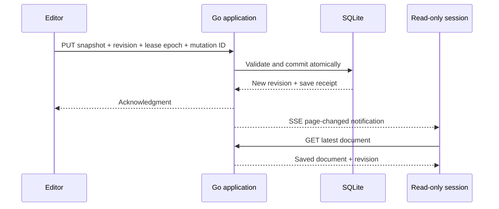

# mindflow — Canvas, saving, and editor control

Status: technical draft, 12 November 2026. Interview decisions are identified below; unconfirmed numerical defaults are implementation proposals.

Related documents: [Product requirements](REQUIREMENTS.md), [Architecture](ARCHITECTURE.md), [Deployment](DEPLOYMENT.md).

## 1. Document model

Use a renderer-independent JSON document with an explicit schema version. A document contains an ordered list of elements, group membership, and page settings. The server supplies a separate monotonically increasing revision. Camera, current selection, pending placement, undo history, and editor leases are not content.

Common element fields:

| Field | Meaning |
| --- | --- |
| `id` | Stable random element identity. |
| `type` | `image`, `shape`, `text`, or `stroke`. |
| `x`, `y` | Center in world/canvas coordinates. |
| `width`, `height` | Positive local bounds; explicit minimum sizes prevent singular transforms. |
| `rotation` | Angle in radians, normalized on commit. |
| `groupId` | Optional membership in a top-level selection group. |
| Type-specific payload | Asset ID, shape style, text/style, or stroke points/style. |

The element list defines back-to-front stacking. Initial groups are non-nested collections of elements; transforms update member geometry rather than storing a second conflicting transform hierarchy. Grouping does not rasterize elements or erase text/stroke semantics.

Store shape geometry in local coordinates. Store stroke points in a normalized local coordinate system with a pen width; transforms resize/rotate the resulting geometry. For nonuniform resizing, propose keeping the stroke's scalar pen width unchanged while its path stretches. This needs a visual prototype check.

Text stores plain Unicode text and one style object for the entire element: whole-number font size, bold, italic, horizontal alignment, vertical alignment (top/middle/bottom), color, and a bundled or consistently available font family. No HTML or per-word styles are persisted. Use the same font metrics for canvas display and the HTML input overlay.

Page settings include background (dots/plain), grid spacing, and snapping enabled. Default spacing is 20 world units and must be configurable to a positive value. Proposed snapping default is off. Light/dark appearance follows system settings initially, with user preference stored in SQLite.

Schema changes require explicit migrations. Reject newer unsupported formats rather than dropping unknown fields on save. Page duplication remaps element/group IDs while preserving geometry and valid asset references.

## 2. Coordinates and rendering

Render a viewport-sized canvas, not a huge bitmap. World coordinates map through a camera translation and uniform zoom. Panning changes the camera; it does not rewrite element positions. Background dots are rendered for the visible viewport only.

Cursor-centered zoom preserves the world point under the cursor. For screen point `s`, camera offset `t`, and zoom `z`, the world point is `(s - t) / z`. After choosing new zoom `z2`, set offset to `s - worldPoint * z2`.

Proposed zoom range is 5%–2,000%, with smooth bounded wheel increments. These are initial usability defaults, not an assertion of literally infinite numeric precision. Validate finite coordinates and prototype usable ranges without introducing a visible fixed page boundary.

Use viewport culling, a spatial lookup for candidate elements, bounded decoded-image caching, and a small number of canvas layers. Offscreen elements remain in the document without needing active render nodes. High-frequency gesture previews avoid full document serialization. Konva recommends viewport-sized stages and minimizing unnecessary drawing/layers. [Konva performance guidance](https://konvajs.org/docs/performance/All_Performance_Tips.html)

## 3. Input and interaction rules

| Gesture / action | Behavior |
| --- | --- |
| Wheel/trackpad scroll over canvas | Cursor-centered zoom. |
| Cmd + drag on macOS / Ctrl + drag elsewhere | Pan, overriding the active canvas tool. |
| Drag empty canvas in selection mode | Freehand lasso. |
| Click element | Select it. |
| Shift + click | Proposed additive selection toggle. |
| Drag selection | Move selected elements. |
| Corner image handle | Resize with original selection aspect ratio preserved. |
| Side image handle | Resize without preserving aspect ratio. |
| Text side handle | Change box width and wrapping without changing font size. |
| Text corner handle | Uniformly scale text box and round font size to a whole number. |
| Rotation handle | Rotate selected element(s). |
| Escape | Cancel gesture/placement, then clear selection if idle. |

Canvas shortcuts must not fire while typing into text fields. Proposed familiar shortcuts are Cmd/Ctrl+Z for undo, Shift+Cmd/Ctrl+Z for redo, Cmd/Ctrl+C/V for copy/paste, Cmd/Ctrl+D for duplicate, and Delete/Backspace for removal. Capture wheel input only within the editor canvas, preserving normal scrolling in dialogs and lists. OS/browser gesture conflicts must be tested in both supported browsers.

### Lasso

The lasso selects only fully enclosed elements, as agreed. Simplify sampled pointer points into a polygon and evaluate containment in world coordinates. Candidate spatial bounds reduce the number of exact checks.

Proposed enclosure semantics: the entire rendered footprint must lie inside or on the lasso boundary. Consider transformed shape edges, image/text bounds, and stroke width, not only an element's center. Checking only corners is insufficient for a concave lasso; test edge intersections as well. An initial group is selected only when all its members are enclosed.

### Snapping

When enabled, snap positions and resize handles to the configured world grid. Snap the selection's anchor during movement to preserve relative offsets. Image corner aspect ratio and text corner uniform scaling take precedence over independently snapping both dimensions; use the nearest valid constrained result. Rotation snapping is not part of the agreed grid feature.

### Drawing, transforms, and history

A completed pen stroke is one editable element and one undo entry. Moving, rotating, or resizing a selection is one undo entry per completed gesture. Property changes are coalesced into useful undo steps rather than recording every keystroke or pointer event. A new edit clears redo history.

Use an HTML textarea/editor overlay for text, transformed to follow its canvas position, rotation, and zoom. Commit text edits on an explicit finish action or focus change; Escape cancels the current text-edit transaction. During typing, autosave must periodically capture completed text state without ending the editing experience.

Maintain independent undo stacks per page while that page remains open in the workspace session. Switching tabs preserves them; a full reload need not. For a multi-page workspace, unsaved documents remain in memory when changing tabs. Background dirty pages continue saving until clean before their edit lease is released.

## 4. Image insertion and variants

### Insertion

Accept PNG, JPEG, and WebP from file upload, drag-and-drop, and clipboard paste. Validate file signatures, decoded dimensions, MIME type, and limits on the server; filenames and browser MIME declarations are not sufficient. Initially reject animated images with a clear message rather than silently changing them.

Insertion enters cursor-following placement mode; click commits placement and Escape cancels. For several incoming images, propose sequential placement, one image per click. Create local object URLs from browser-held original files so placement works while disconnected. Keep unsent original bytes in session memory until acknowledged by the server.

During save, upload pending original images first, substitute their returned asset IDs into the document, then save that document. A failed upload leaves the page unsaved. Canceling before placement needs no server upload. Orphan cleanup handles interrupted uploads that never become referenced.

Normalize EXIF orientation for rendering and dimension calculations without modifying the stored original bytes. Derived images must not copy unnecessary metadata. The first prototype must confirm consistent JPEG orientation between canvas decoding and Go processing.

### Variant generation

Agreed behavior: preserve the original, generate downscaled versions when the requested size is more than 20% below original size, and serve a suitable version instead of loading a large original for a small display. Variant work runs after saves and does not block acknowledgment of saved content.

Proposed algorithm:

1. A saved image placement supplies width/height in world units. Combine its size with zoom and device pixel ratio when computing the useful render resolution; world size alone is not a screen-pixel size.
2. Preserve source aspect ratio in the encoded image. For source dimensions `(Ow, Oh)` and required screen dimensions `(Rw, Rh)`, use `s = min(1, max(Rw/Ow, Rh/Oh))`. This covers both axes even when the canvas element is intentionally stretched.
3. Generate a variant only if the rounded resolution still has a linear scale below `0.8`. At exactly 20% reduction, keep the existing version. Never upscale beyond the original.
4. Round requested sizes upward into a bounded set of size buckets, proposed longest edges 128, 256, 512, 1024, 2048, 4096, and 8192 pixels, with an additional per-asset bucket just below 80% of original resolution when needed to bridge the final size gap; reuse variants across placements of the same owned asset.
5. On save, enqueue a default-view variant, using world size at 100% zoom as a baseline. The active client can also request an authorized on-demand variant for its current zoom/display density, including for a read-only view. These are media requests, not document edits.
6. The client chooses the smallest available variant that covers its render resolution, or the original if necessary. Existing decoded content remains visible during generation. Initial display may use the original when no smaller version exists yet.

Limit and deduplicate jobs by asset, size bucket, and encoder version. Do not regenerate a variant on each resize event or wheel tick. Debounce requests, reuse buckets, and discard obsolete queued work where practical. Use JPEG for opaque photographic derivatives and PNG for transparent derivatives initially; verify quality and encoder support in the prototype. Preserve the original upload format and bytes regardless of derivative format.

All versions are stored as SQLite BLOBs. Every metadata/variant/original request checks user ownership, including on-demand job creation. No publicly accessible asset URLs or cross-user content hashes are exposed.

## 5. Save protocol

Use HTTP for mutations and SSE for notifications. No live cursor or unfinished-stroke transport is required. Send complete page JSON snapshots initially; image BLOBs are uploaded separately. Prototype measurements determine whether incremental mutations become necessary.

Proposed scheduling: debounce completed edits by 750 ms, with a maximum five-second interval during continuous activity. Never serialize a half-constructed drawing gesture. Keep one save in flight per page and coalesce later edits into the next snapshot.

Every save contains:

- Expected server revision.
- Current editor client ID and lease epoch.
- Unique mutation ID, reused only when retrying exactly the same request.
- Versioned document snapshot and its referenced uploaded asset IDs.

In one write transaction, the server checks authentication, active account, page ownership, current unexpired lease/epoch, expected revision, payload constraints, and asset ownership. It then commits the document, retained asset links, incremented revision, and a save receipt. Emit change events only after commit.

A retry with the same mutation ID and same request digest returns the original acknowledgment without applying it again. Reusing an ID with different content is an error. Receipts are proposed to last 24 hours; after expiration, a stale expected revision must still reject a replay. Authorization is checked before returning any receipt, even if the editor no longer owns the lease.

Track local edit generations separately from acknowledged server revisions. Acknowledging generation N must not mark edits N+1 as saved. On ambiguous failures, retry the exact request or fetch the authoritative revision before sending a new mutation.

Use visible states: Saved, Saving, Unsaved, Disconnected, Save failed, and Control lost. “Saved” means all current local changes and referenced images have committed to the server. Variant generation may still run independently.

## 6. Single-editor leases and takeover

A lease is scoped to one page and one browser client/tab within an authenticated session. Different pages may be edited independently. Client IDs alone are not credentials; every operation requires the owning authenticated session and current lease state.

Proposed timing: renew every 15 seconds, expire after 60 seconds without successful renewal. A browser close releases best-effort; correctness depends on expiry, never on receiving a close notification. Timer throttling may expire background-tab leases; returning clients must verify control before saving.

Opening a page atomically attempts acquisition if there is no live holder. Otherwise show its latest saved document read-only with a “Take control” action. Takeover is explicit and confirmed. It atomically replaces the holder, increments the persisted epoch, and notifies both sessions. An epoch never resets on expiry/release, preventing old saves from becoming valid again.

The server must check lease fencing inside the same transaction as every page-content mutation. Save and takeover races therefore serialize: either the old save commits before takeover, or it is rejected afterward. SSE delivery speed is not a correctness mechanism.

The displaced online client immediately becomes read-only, cancels active gestures, and retains dirty state separately from its current server view. A disconnected client cannot learn about takeover immediately; it may continue editing locally, but its writes are rejected when it reconnects.

If a lease expires without another editor making changes, the client may reacquire and save only after checking the current revision and active holder. If another client took control or the document revision diverged, do not silently replay changes into the original page. Use recovery-copy flow.

On server startup, invalidate prior live lease holders by advancing epochs/expiring leases. Reconnecting clients must revalidate. An SSE reconnect alone never grants edit control.

## 7. Notifications and read-only updates

Use one authenticated same-origin SSE stream per browser client, carrying minimal invalidations such as page revision, lease change, workspace change, and account/session revocation. It contains no other users' content and no raw lease/session secrets.

Read-only clients automatically fetch new saved revisions, coalescing bursts. Retain camera and selection where possible. They do not receive live drawing gestures. If the client holds a recovery copy, receiving server content must never overwrite that copy.

Send periodic SSE keepalives. On reconnect, perform authoritative metadata/revision/lease synchronization, because notifications are transient rather than a persisted event log. If SSE is unavailable, fall back to proposed five-second polling while visible. Lease renewals and write authorization still use HTTP and remain authoritative.

## 8. Disconnected editing and recovery

Keep documents, undo state, pending snapshots, local uploads, and recovery copies in browser memory only. No service worker, IndexedDB draft persistence, or local-storage document persistence is required.

While disconnected, continue editing content already available in the session. Unloaded images/pages may be unavailable; show that clearly. New workspace/account/server operations cannot be confirmed offline. Retry pending saves on reconnect using bounded backoff with jitter.

On reconnect:

1. Recheck authentication and account status.
2. Resolve uncertain prior save results.
3. Fetch current page revision and lease status.
4. Renew/reacquire valid control only if safe; otherwise preserve local changes for recovery.
5. Upload pending images and save only under valid fencing/revision checks.

### Recovery copy

If control was stolen or revisions diverged, show the latest saved page read-only and a persistent notice that unsaved local work is retained. Offer “Save as a separate page” and “Discard local changes.” Discard requires confirmation.

Saving a separate page creates an independently editable copy from the retained local document, remaps element IDs, uploads pending originals, and attaches still-owned asset references. This does not take control of or modify the original page. Only clear recovery state after the new page is durably acknowledged.

If the source page/workspace was deleted, offer another owned workspace or creation of a replacement workspace after reconnecting. Assets deleted elsewhere may no longer be recoverable if the browser holds only a preview; report missing assets and ask the user to reattach or explicitly remove them. Do not claim recovery succeeded while silently dropping images.

An expired login can be renewed without discarding in-memory work through an in-app login dialog. A deactivated/deleted user cannot bypass authorization through recovery. Logging out warns about unsaved work and clears private in-memory content after confirmation; account revocation stops all subsequent server access.

Register `beforeunload` only while there is unsaved/recovery work and require confirmation for in-app navigation that would discard it. Browser-native close/reload dialogs are subject to browser restrictions and cannot guarantee protection against crashes, forced quits, or termination.

## 9. Prototype and release validation

Before committing to Konva, verify:

- Rotated shapes, images, strokes, text, and groups behave consistently.
- Concave freehand lasso correctly requires full containment.
- Image corners preserve ratio and sides stretch; grid constraints remain coherent.
- Text side resizing wraps and corner resizing scales text, with matching HTML/canvas layout.
- Zoom, panning, and image sharpness work at device pixel ratios 1 and 2 in Chrome/Firefox.
- A representative 3,000-element page with 200 varied image placements remains usable.

Proposed performance goals on a recorded representative desktop: median pan/zoom frame time at or below 16.7 ms and 95th percentile below 33.3 ms after visible assets load; local transform feedback within 50 ms; ordinary save acknowledgment within one second on the home-server path excluding upload, debounce, and external-network delays. Report actual fixture sizes, hardware, browser versions, memory, network, and image-decoding costs rather than presenting these targets as guarantees.

Test save retry after a committed-but-lost acknowledgment, edits during an in-flight save, disconnect with pending uploads, lease expiry, simultaneous acquisition/takeover, disconnected old-editor reconnect, session revocation, server restart, page deletion, and read-only refresh while a recovery copy exists. Verify that stale saves never overwrite accepted work and that user content cannot cross ownership boundaries.

## Implementation notes

The prototype uses Konva with a renderer-independent persisted model. In-memory camera state survives page-tab switches. A page with a pending recovery copy must save or discard that copy before taking control again, preventing a second displacement from overwriting earlier local work. An unmodified page can automatically reacquire its expired lease after reconnecting; ambiguous saves are retried with their original mutation identity first. See [IMPLEMENTATION.md](IMPLEMENTATION.md) for actual browser and performance results.

### Image crop representation

An optional image `crop` stores `{x, y, width, height}` as fractions of the original image. Missing crop means the full source. Bounds are validated on the client and server. Rendering converts the crop to pixels in whichever original/variant is decoded. Required variant resolution accounts for the retained fraction, so a narrow crop does not magnify a low-resolution preview. Applying a crop adjusts the element bounds while retaining the source pixels at their existing world positions, including rotation. Reset reverses that calculation. Originals and other placements remain unchanged. Crop edits use normal document history, autosave, duplication and recovery.

Text `verticalAlign` defaults to `top` for existing documents. The renderer uses [Konva vertical alignment](https://konvajs.org/api/Konva.Text.html); the textarea overlay measures wrapping with matching font metrics and applies the corresponding top padding. New font sizes and corner-resize results are integers; legacy fractional sizes are rounded for display and input.
