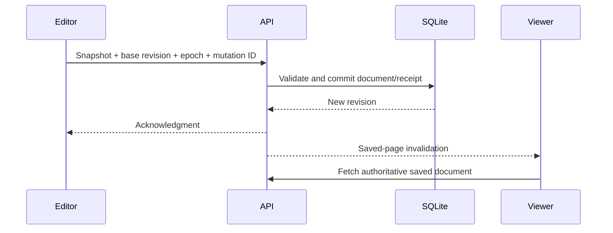

# Canvas and synchronization

This page describes the current protocol. See the [data model](data-model.md) for persisted fields and the [user guide](../user-docs/using-mindflow.md) for controls.

## Coordinates and input

The camera maps world coordinates into a viewport-sized Konva stage. Pan/zoom updates camera state, never the stored element coordinates. Zoom centers on the cursor; rendering culls distant content and reuses decoded images.

On first opening a saved nonempty page, the camera fits its content. Session cameras take precedence when returning to a page.

Element bounds are centered local coordinates with rotation. Lasso containment uses transformed footprints and selects only fully enclosed elements, including groups. Snapping uses configurable world units when moving/resizing. Insertion previews are outside the document until release; their initial bounds are minimal so they do not flash default-sized content. A click without dragging uses default dimensions. Pen strokes are collected into normalized local points.

Text input uses matching Konva/textarea font metrics and wrapping. Image crop rectangles are normalized against the original; display-resolution requests account for crop fraction, zoom, and display density. Smaller variants are generated only when useful below the 0.8 scale threshold, never by replacing/upscaling the original. Jobs are bounded and deduplicated, and existing decoded content can remain visible while a better variant is generated.

## Editor layout

`App` owns the session-only collapsed-header state. The workspace layout uses a flex column within the dynamic viewport, with update notices above its content frame. Collapsing hides the app header, workspace heading, and page tabs through CSS without remounting `WorkspaceEditor` or `Canvas`; the canvas's existing resize observer updates its viewport. A floating arrow restores navigation and remains clear of drawing controls on coarse-pointer devices. Dashboard navigation always shows the normal header.

## Touch and Pencil input

`useCanvasInput` routes Pointer Events for mouse, touch, and pen into the same creation, lasso, and stroke handlers. DOM pointer capture keeps a gesture active when its pointer leaves the stage. Coalesced Pencil samples are collected where the browser exposes them. Konva retains its native mouse/touch dragging and Transformer behavior; the input hook explicitly stops and restores those operations before switching to navigation or handling cancellation.

The first touch uses the current tool. Two touches cancel that unfinished tool gesture and establish a camera snapshot; `touchNavigation` applies their relative distance and midpoint movement, clamped to the normal zoom range. Remaining touches are suspended until all navigation fingers lift. Pencil takes priority over existing finger gestures, and additional finger contacts are ignored while it is down. Optional Pencil-only drawing maps a lone finger to pan. This is contact-based palm filtering, not hardware palm classification. Pen input can capture per-point pressure; mouse, finger and highlighter strokes retain constant width. Stabilization filters new stroke positions, while hold detection uses raw pointer positions. See [pressure ink](data-model.md#pressure-ink).

Pointer cancellation, lost capture, window blur, hidden tabs, and window resizing discard unfinished touch/Pencil gestures. Mouse interruptions finish at the last pressed position and commit native drags/transforms instead of restoring the old document. Release is handled in DOM capture with a window mouse-release fallback; creation bounds and the final stroke/lasso point come from release coordinates rather than a potentially stale rendered preview. A mouse move reporting no pressed buttons also finishes a missed release. Comment and template placement commit on release so navigation can cancel them too. Native drag/transform cancellation restores document coordinates and suppresses a transform commit. Camera gestures never mutate saved elements.

CSS `touch-action: none` and selection/callout suppression apply to `.konvajs-content`, leaving surrounding forms and scrollable controls usable. Overscroll chaining is disabled on the document to prevent pull-to-refresh. Coarse pointers get larger controls/handles. Pencil double-taps open object properties at the pointer, including on text; mouse/finger double-clicks retain text editing. Text input focuses synchronously and has an explicit Done action that follows the visual viewport above overlaid software keyboards.

## Saving

Completed edits are debounced by 750ms, with a maximum five-second interval during continuous activity, excluding unfinished gestures and network/upload delays. Each page has one save in flight; later edits are coalesced. Upload local image bytes separately before sending references in the page snapshot.

Every save sends `baseRevision`, `clientId`, `epoch`, `mutationId`, and the complete versioned document. In one transaction the server verifies current workspace edit access, editor lease/epoch, expected revision, payload limits, and target-workspace asset access. It commits the document, retained asset links, new revision, and receipt before publishing invalidations.

A repeated mutation ID with the same digest returns its original acknowledgment. Reusing it for different content is rejected. Receipt access is authorized even when the caller has lost editor control; stale expected revisions still prevent replay after receipt expiry. The client tracks local generations separately from server revisions, so acknowledging one save cannot mark subsequent edits as saved.

## Editor control

Leases are scoped to one page and a client within an authenticated session. The lease lasts 60 seconds and an active client renews about every 15 seconds. Client IDs are not credentials. Startup expires old holders and cancels pending requests; clients must revalidate.

Acquisition grants a free lease. An active holder requires a ten-second control request: the holder may accept/deny, the requester may cancel, and server operations finalize a due request automatically. A repeated request does not extend its deadline. Transfer rechecks the requester's account/session and edit permission, then replaces the holder and advances the epoch. Owner-only `force` cancels pending approval and transfers immediately; administrator status does not bypass ownership.

Save/control races serialize in the database. Saves after the request deadline or from a stale epoch are rejected. Notifications are not the correctness mechanism.

## Notifications, disconnection, and recovery

One authenticated SSE stream carries minimal invalidations, not document bodies or live gestures. Recipients follow current workspace access. Clients fetch authoritative state after events/reconnect and also poll for saved revision/control changes. A lost event cannot grant access or make a stale save valid.

Loaded pages may be edited in memory while disconnected. Ambiguous saves retry the same mutation before a new one is issued. Reconnection verifies revision and control. If control is lost or content diverged, keep dirty work as a separate recovery document, show the latest server document read-only, and offer creating a recovered page. Incoming saved content never overwrites that recovery copy. Local image bytes remain available while pending uploads/recovery need them.

No persistent browser offline store is used. Page sessions retain camera, undo/redo, and drafts while mounted in the workspace; leaving/reloading invokes unsaved-work protection. Browser crashes can still lose drafts.

## Navigation and build notifications

`#/workspaces/{workspaceId}/pages/{pageId}` identifies the selected page. A workspace-only route selects its first page. Routes survive sign-in, enforce workspace/page membership, and preserve unsaved-work checks across browser history.

The server identifies its executable once at startup and embeds the identifier in HTML. Clients compare it with the public, no-store `/api/v1/version` response every minute and on foreground events. A mismatch offers explicit reload through the normal unsaved-work guard. Direct Vite development has no production marker and does not show deployment notices.

## PDF import and viewing

`features/pdf` loads PDF.js and its worker only when needed. CMaps, font data, ICC resources, and the worker are served locally; the build copies support files with `scripts/copy-pdf-assets.mjs`. The renderer uses canvas only, without an interactive annotation layer, XFA, dynamic font loading, or WebAssembly. Existing annotation appearances are rasterized. Each page is rendered sequentially at a bounded resolution, with load/render timeouts and cancellation cleanup.

`workspace/pdf` owns upload and batch-page endpoints. Its database access lives in the parent `workspace/storage` package and generated sqlc queries. Uploads retain bounded opaque PDF bytes and a bounded PNG thumbnail in one transaction after checking current write access. Signature/trailer checks are not a full server-side PDF parse. Originals are returned with attachment disposition; the in-app viewer fetches their bytes through the protected asset endpoint. Image variants cannot be generated for PDF originals by the image worker. Batch page creation validates names, geometry, MIME types, and workspace asset access before committing all pages. Image uploads made during a cancelled or failed conversion use ordinary unused-asset cleanup.
