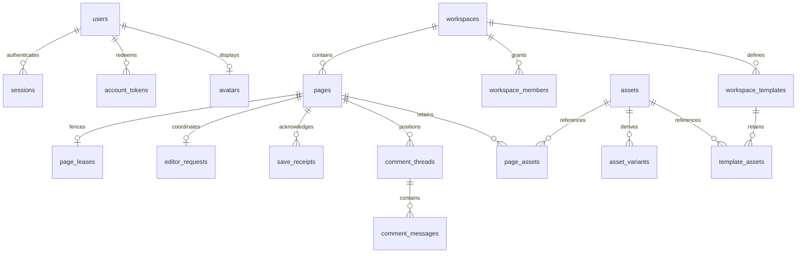

# Data structures

SQLite is the persistent store for documents, original/derived image BLOBs, accounts, configuration, and queued jobs. The connection enables foreign keys, WAL, full synchronization, and a busy timeout, with one serialized connection. Run one application instance per database.

## Schema ownership

| Domain       | Tables/views                                                                                       | Purpose                                                                                                                    |
| ------------ | -------------------------------------------------------------------------------------------------- | -------------------------------------------------------------------------------------------------------------------------- |
| Account      | `users`, `sessions`, `account_tokens`, `avatars`, `account_activity`, `account_update_preferences` | Account roles/status/preferences, password hashes, revocable sessions, expiring invitation/reset tokens, and profile PNGs. |
| Workspace    | `workspaces`, `pages`, `workspace_members`                                                         | Ownership, titles/order, metadata revisions, page JSON, and explicit member roles.                                         |
| Workspace    | `page_leases`, `editor_requests`                                                                   | Current writer/session/client, fencing epoch/expiry, and pending/finished control requests.                                |
| Workspace    | `assets`, `asset_variants`, `page_assets`                                                          | Immutable originals, size-bucket variants, and retained page/image associations.                                           |
| Workspace    | `save_receipts`, `image_jobs`                                                                      | Idempotent save acknowledgments and deferred image processing.                                                             |
| Workspace    | `workspace_templates`, `template_assets`                                                           | Named reusable element snapshots and retained image references.                                                            |
| Workspace    | `comment_threads`, `comment_messages`                                                              | Positioned discussions, authorship, replies, and resolution.                                                               |
| Workspace    | `workspace_access`, `asset_access`, `active_workspaces`, `active_pages`, `active_assets` views     | Workspace roles and authorized image visibility.                                                                           |
| Email        | `mail_jobs`, `mail_deliveries`                                                                     | Deduplicated credential and welcome email, attempts, next run, and delivery status.                                        |
| Release      | `release_state`                                                                                    | Highest observed release; announcements and version advancement commit atomically.                                         |
| Feedback     | `feedback_reports`, `feedback_comments`, `feedback_events`, `feedback_reads`                       | Private reports, normalized PNG screenshots, discussion and release-linked decisions.                                      |
| Installation | `app_settings`                                                                                     | Singleton initialization state, public URL, and SMTP configuration.                                                        |

Each top-level domain owns its migrations and `goose_<domain>_version` history table. Subdomains share their parent's history. Account IDs in workspace/email records are opaque references; no query or foreign key reaches another domain's tables. Services coordinate lifecycle cleanup explicitly.

Core relationships within schemas:



## Canvas JSON

A page's `document` is versioned JSON. `pages.revision` tracks saved document changes; `metadata_revision` is separate from content revision, and workspace revision protects workspace/page-order metadata.

```json
{
  "schemaVersion": 1,
  "elements": [
    {
      "id": "element-id",
      "type": "shape",
      "shape": "rectangle",
      "x": 100,
      "y": 80,
      "width": 160,
      "height": 120,
      "rotation": 0,
      "fill": "#edf5df",
      "border": "#1b5e3b",
      "borderWidth": 2
    }
  ],
  "settings": { "background": "dots", "gridSize": 20, "snap": false }
}
```

`settings.defaultFill`, `defaultBorder`, and `defaultTextColor` optionally store validated default colors for newly created shapes/text on that page. New pages explicitly use Forest (`#1b5e3b`), Gold (`#d9a441`), and Gold respectively. Missing/empty fields on legacy pages use frontend fallbacks without changing existing elements. Settings are saved in the normal document snapshot; no SQL migration or schema-version change is required.

`settings.backgroundColor` optionally stores a validated CSS color, independent of the dot/plain background pattern. Omitting it keeps the normal theme background. Butterfly imports use it to preserve solid page colors; existing documents require no migration.

The ordered element list defines stacking, back to front. Common fields are stable `id`, `type`, center `x/y` in world units, positive local `width/height`, rotation in radians, and optional `groupId`. Groups are flat memberships; transforms update the member elements. Optional `locked: true` marks group members as fixed in the editor. Every member of a group must have the same lock state; ungrouped elements cannot be locked. Missing `locked` means false. No document-schema bump is required.

| Element type | Additional fields                                                                                                                   |
| ------------ | ----------------------------------------------------------------------------------------------------------------------------------- |
| `shape`      | `shape` (`rectangle`, `circle`, `star`), fill, border, border width.                                                                |
| `text`       | Plain text, whole-number font size, bold/italic, color, horizontal and vertical alignment. Formatting applies to the whole element. |
| `stroke`     | Normalized local point pairs, color, and pen width. Resizing stretches the path.                                                    |
| `image`      | Asset ID and optional normalized `crop` rectangle (`x`, `y`, `width`, `height`). Cropping never modifies the original BLOB.         |

New text defaults to horizontal center/vertical middle. Legacy missing alignment fields retain the renderer's fallback behavior. Camera, selection, insertion preview, undo history, and recovery state are not document content. A page supports at most 10,000 elements; unsupported document schemas and invalid payloads are rejected.

## Lifecycles and storage details

- Image originals are immutable. Variants are keyed by asset and resolution bucket; a workspace can scope uploads to its owner. `page_assets` and `template_assets` retain images for page history/recovery and reusable snapshots, and duplicate pages can share those originals. Removing an element does not immediately destroy its retained image.
- Workspace deletion cascades through its pages, memberships, discussions, and related page records. Cross-domain account deletion removes owned content and related memberships/authored discussion/requests through service collaborators. Shared uploads belong to the workspace owner, so deleting their uploader does not remove retained shared content.
- Workspace templates store validated element JSON separately from pages, with bounded counts and size. They have no dependency on source element IDs or page lifetimes. Insertions assign fresh IDs, remove grouping/locks, and retain immutable image references. Workspace copies retain template assets across deletion of the source workspace.
- Comment threads/messages live outside the page JSON and its document revision. Authors and permissions are assigned/checked by the server.
- Avatar uploads become metadata-free 128px square PNGs; `users.avatar_version` changes when the image changes.
- Sessions store verifier hashes; invitation/reset records store token hashes. Pending email payloads and SMTP configuration are sensitive backup contents.
- Save receipts include a request digest and resulting revision, expiring after 24 hours. Lease epochs prevent an old client from becoming a valid writer again after transfer or expiry.

The authoritative definitions are the [account](../../internal/account/storage/migrations), [workspace](../../internal/workspace/storage/migrations), [email](../../internal/email/storage/migrations), and [installation](../../internal/installation/storage/migrations) migrations, plus the [frontend model](../../web/src/model.ts). HTTP payloads are in [OpenAPI](../../api/openapi.yaml).

List text adds optional `listStyle` (`bullet`, `number`, `check`) and `checked` line indices; a text element still stores newline-separated `text`. Highlights are ordinary strokes with optional `highlight: true`, rendered at 35% opacity with multiply blending. These fields are additive to schema version 1.

PDF elements use `type: "pdf"` and an `assetId`. The parent workspace's existing `assets` table stores the original with MIME `application/pdf`; `asset_variants` stores a first-page PNG under bucket 1024. Width/height describe the thumbnail. Page/template asset links retain the original and preview through copies and lifecycle operations, using the existing workspace asset permissions. No separate PDF database or cross-domain schema is introduced. Image-mode imports use normal PNG assets and image elements.

Account migration 3 adds `users.display_name` and backfills existing accounts from the email local part (up to 80 characters). New account writes store a normalized name. The authenticated directory exposes only active account IDs, display names, and avatar versions. Sharing uses stable account IDs; duplicate or changed names do not change access. Legacy exact-email API grants remain supported. Workspace migration 5 adds the requester-name snapshot to the existing editor-control request record. Comment author and membership names resolve through the account service without cross-domain table queries.

## Pressure ink

Pen strokes may contain `pressures`, an array of finite values in `[0, 1]`, with one value per coordinate pair in `points` (at most 20,000 samples). It is only valid on non-highlight strokes. Omission preserves legacy constant-width rendering. Width is `penWidth × (0.2 + 0.8 × pressure)`, so `penWidth` is the maximum pressure width. This is an optional field in canvas schema version 1 and native format version 1; no database migration is needed. Geometry and pressures are copied together through templates and native transfers.

`InkStroke` captures pressure and smooths new centerline samples at Off, Light or Strong settings. Its distance-based filter uses screen pixels so the response stays consistent across zoom levels. Release commits the exact physical endpoint while retaining the last contact pressure. Hold detection uses raw pointer coordinates, independently of smoothing. Straightening redistributes the existing pressure profile along a straight line using cumulative path length; subsequent motion adjusts the line endpoint. Constant-width profiles collapse to two points.

`strokeGeometry` builds a filled ribbon with round caps; live preview, the editor, PDF/PNG exports and workspace thumbnails use the same pressure-width mapping. Preview geometry updates at most once per animation frame, while all coalesced pointer samples retain their individual pressures. Lasso containment uses each sample's effective radius. Stabilization settings are transient tool state; the smoothed output points are persisted, so no filter is rerun on reload or export.

## Retention, ownership, and element links

Workspace migration `00006_trash.sql` adds non-null Unix-second `deleted_at` columns (zero means active) and indexes to `workspaces` and `pages`. Active views and access views hide deleted parents/children and media referenced exclusively by trashed content. Retained references prevent ordinary orphan cleanup from deleting recoverable media. The `workspace/trash` subdomain restores within the 30-day cutoff and purges expired content in bounded transactions through the background worker. Account deletion calls the existing immediate hard-delete workflow, including trashed data. Restores and ownership changes fence old leases and cancel approval requests.

`workspace/ownership` orchestrates transfers using only parent `workspace/storage` SQL and account service lookups. Exclusive media is reassigned; media also used by other workspaces is cloned with all variants and page/template references rewritten. This makes account deletion independent in either direction. All changes, membership updates, and lease fencing commit together under optimistic workspace metadata revision control.

Every canvas element may have `link: { "pageId": "...", "elementId": "..." }`. Newly assigned targets must exist on an active page in the same workspace; unchanged links may retain missing targets to support Trash restoration. No SQL foreign key couples embedded element identities to page lifecycle. Coordinated copies remap page/element/group identities before writing; links outside a portable selection are removed. The format remains schema version 1 because the field is optional.

Welcome jobs use a per-account deduplication key, queue atomically with initial setup or invitation redemption, and verify current account eligibility before delivery. The outbox is independent from SMTP configuration; it can queue within setup's transaction without reading uncommitted settings through another database connection.

Account activity migration gives existing accounts a fresh activity baseline at upgrade. Newly activated accounts start their baseline at activation. Inactivity deadlines begin at successful delivery, and a delayed final notice extends deletion until at least seven days after delivery. Deactivated and unactivated accounts are excluded because they cannot sign in; active administrators are exempt. Account removal deletes its update capabilities and preferences, owned feedback, authored report comments and owned workspaces immediately. Email removes account-linked queued messages and delivery receipts through its own storage boundary.

Unsubscribe tokens are random capabilities stored only as SHA-256 digests in `account_tokens` with purpose `updates_unsubscribe`. They cannot create sessions or reset passwords. All links issued during a consent cycle remain usable; withdrawing consent removes them. They are independent of invitation/reset expiry cleanup.

Feedback states are `created`, `accepted`, and `closed`; deny is a transition to closed with a mandatory comment. Accept/reopen also record discussion entries, and release closure derives a validated version tag from its comment. State changes and comments/events commit in one transaction. The lifecycle migration maps existing submitted reports to created and denied reports to closed while retaining media and discussions.

Feedback activity uses monotonically increasing event IDs, including a report-creation event and each discussion entry. Read positions belong to an opaque user ID and report, with no cross-domain foreign keys. A read acknowledgement is bounded by the snapshot returned to the client, so a concurrent unseen reply cannot be swallowed by an old acknowledgement. Admin counts include other people's new reports and comments; personal counts include replies on the reader's own reports. Comment order follows event IDs rather than second-resolution timestamps. Account cleanup removes that user's read records; existing report/comment cascades remove their events.
