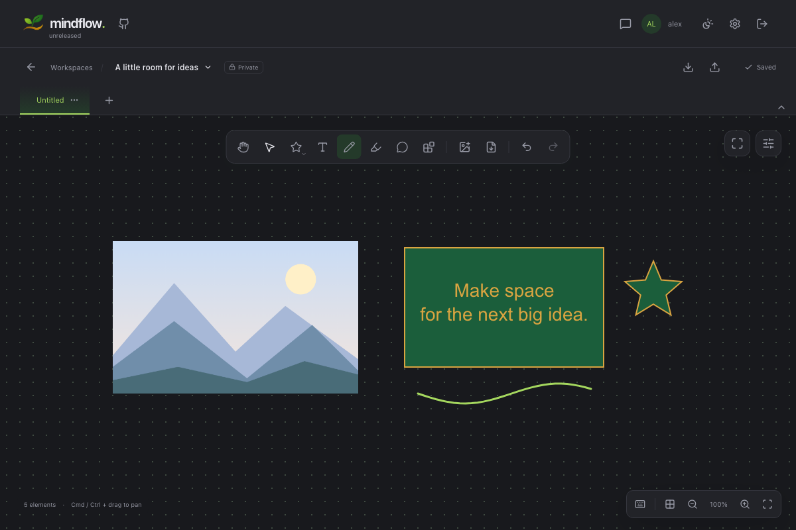
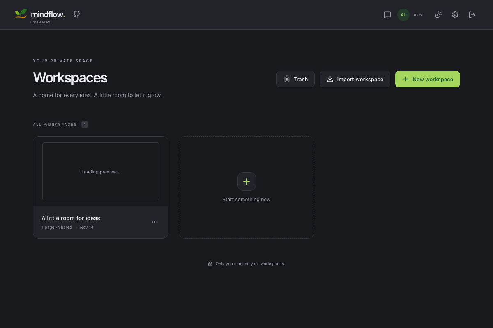
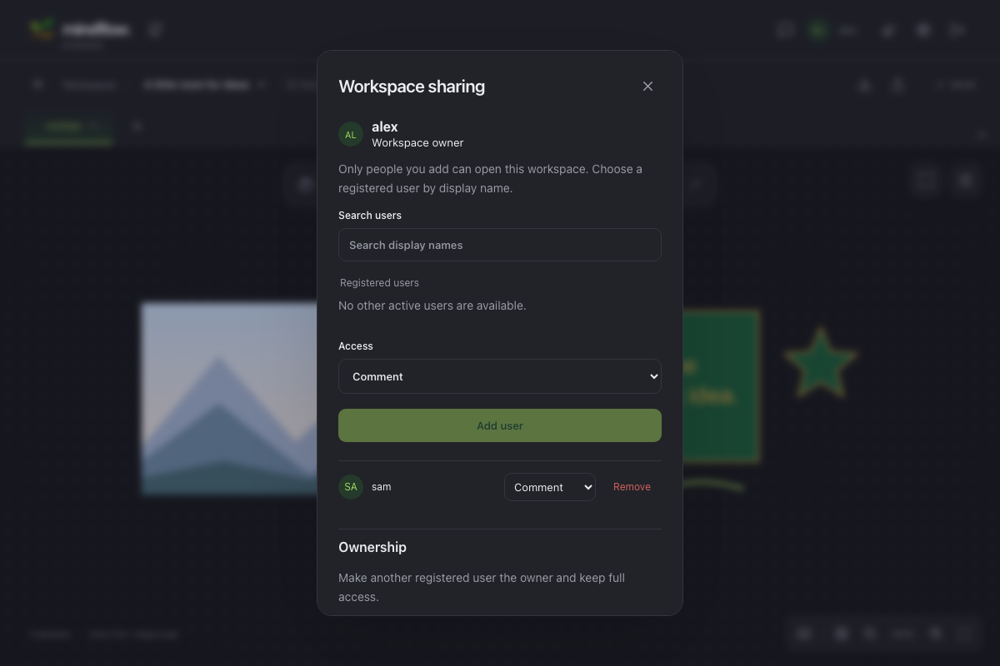
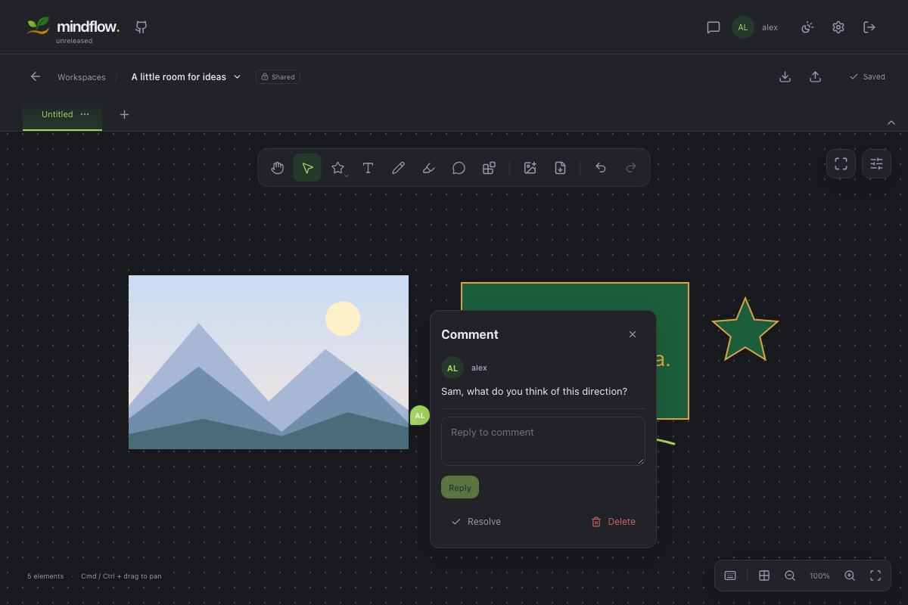

# Using mindflow

Sign in to see your own and shared workspaces. Create a workspace, open it, and use the page tabs to organize separate canvases. Workspaces and pages can be renamed, duplicated, or deleted; page tabs can be reordered. Workspace lifecycle and sharing management belong to the owner. Deleted workspaces and pages remain recoverable for 30 days.

## A first workspace in a minute

1. Choose **New workspace**, give it a name, and open it.
2. Upload or paste an image. Drag to choose its position and size.
3. Open **Shapes** to add a rectangle, circle, or star; use **Text**, **Pen**, or **Highlighter** to build on it.
4. Your work saves automatically. Add pages with **+** and return to **Workspaces** whenever you like.

## Workspace previews

Workspace cards show a small preview of the first page in tab order, fitted to its saved content. Multipage workspaces show stacked sheets and a page-count badge. Saving changes to the first page, changing page order, or deleting the first page refreshes the preview. Blank pages and workspaces with no pages have explicit labels. Previews follow the canvas background and your light/dark appearance, and load as cards come into view. Viewing a preview does not acquire editor control.

## Passwords

Account passwords must contain 8–128 characters. Setup, invitation acceptance, and password reset offer **Suggest good password**: two or three randomly selected English words with special characters between them, totaling 10–15 characters, generated locally in your browser. The suggested value is shown so you can save it; **Hide password** masks it again. Random word choices add unpredictability while remaining easier to remember than random character strings. Use a unique password for mindflow.

## Export workspaces and pages

Choose **Export workspace** beside the save status, **Export** in a workspace card's menu, or **Export page** in a page tab's menu. Choose the whole workspace or tick individual pages, then choose a format:

- **mindflow (.mindflow)** keeps elements editable and includes original media. Optionally include reusable templates. Use this format to move work between mindflow instances or share a copy with another person.
- **PDF** creates one PDF page per selected canvas page, in tab order.
- **PNG images** creates one image per canvas page. A single page downloads as PNG; multiple pages download together in a ZIP.

Visual exports fit all elements with a small margin, including rotated objects and drawings. They use the selected resolution, with optional background and dot grid. An empty canvas exports as a blank page. Embedded PDFs appear as their first-page preview. PDF/PNG copies are flattened and cannot restore editable elements. Comments and user details are not included in any export. Sharing permissions are never copied. Native exports contain original images, including cropped-away portions.

Current-tab changes must save before export; reconnect or recover unsaved work first. Keep the tab open while rendering. Exporting does not require editor control, and all workspace members can export saved content. Anyone receiving a downloaded file can read it independently of workspace permissions.

## Import mindflow files

On the workspace list, choose **Import workspace**, select a `.mindflow` file, name the workspace and choose **Import**. Both whole-workspace and selected-page files create a new private workspace. To add their pages to an existing workspace instead, open it and choose **Import pages** beside the save status. Appending requires owner or full access; existing pages are retained, and new pages are added at the end.

Imported elements are independent editable copies. Groups, locks, settings, original media and included templates are preserved. Template name collisions are renamed and reported. A failed import leaves no partial changes. File limits are 64 MiB compressed, 128 MiB expanded, 100 pages, 100 templates and 1,000 media assets per transfer. If an export is too large, choose fewer pages. See the [native format reference](../developer-docs/native-transfer.md) for full limits.

## Import from Butterfly

On the workspace list, choose **Import workspace**, select a `.bfly` export, enter a workspace name, and choose **Import**. Review the conversion notes, then choose **Open workspace**. The new workspace is private; existing workspaces and the source file are unchanged. A failed import leaves no partial workspace.

The importer supports unencrypted Butterfly **file format version 13** documents with numbered pages. Page names, order, stacking, positions, sizes, rotations, collection groups, and solid background colors are preserved. Supported content becomes editable mindflow elements:

- Embedded PNG/JPEG/WebP images retain their originals and display dimensions.
- Pen paths become selectable, resizable strokes. Pressure, smoothing, and filled strokes are approximated.
- Rectangle and circle/ellipse shapes preserve solid outlines and fills.
- Text preserves its content, one style per element, color, whole-number font size, and basic alignment. Empty labels are omitted. Fonts, rich text, and advanced layout may differ.

Exports can be up to **64 MiB**, with at most **100 pages**. Individual images follow the normal upload limits. External image URLs are never fetched. Other format versions, encrypted files, nested page folders, corrupt or oversized data, and unsupported image constraints are rejected. Unsupported element types (including PDF/SVG elements), gradient shapes, layered/textured backgrounds, areas, waypoints, and animations are skipped or simplified with conversion notes. Keep the original export if you need those features.

Pages open fitted to their content; your camera position is retained when switching pages during the session. Imported background colors are configurable in **Canvas settings**.

## Canvas controls

| Action                   | Control                                                                                                          |
| ------------------------ | ---------------------------------------------------------------------------------------------------------------- |
| Zoom around the cursor   | Scroll.                                                                                                          |
| Pan                      | Pan tool (H), Cmd/Ctrl + drag, or hold the middle mouse button and drag.                                         |
| Select enclosed elements | Drag a freehand lasso in Select mode. An element must be fully contained.                                        |
| Add to selection         | Shift + click or lasso.                                                                                          |
| Create an element        | Choose a tool, drag to preview its size, and release. Shift constrains it to 1:1; a click uses its default size. |
| Undo / redo              | Cmd/Ctrl + Z / Shift + Z, or the toolbar. History is kept only in the current session.                           |
| Copy / paste / duplicate | Cmd/Ctrl + C / V / D.                                                                                            |
| Group / ungroup          | Cmd/Ctrl + G / Shift + G.                                                                                        |
| Delete                   | Delete/Backspace. Pen strokes are selectable elements; there is no eraser.                                       |
| Finish editing text      | Done, or Cmd/Ctrl + Enter.                                                                                       |
| Cancel                   | Escape.                                                                                                          |

The keyboard button in the editor lists shortcuts. Hovering over movable elements shows a grab cursor; dragging shows a grabbing cursor.

## Lists and highlighting

While editing text, choose **Bulleted list**, **Numbered list**, or **Checklist** in the formatting bar beside Done. Each line is an item; choose **Plain text** to remove list formatting. The same choices are available under **List style** in object properties. Lists support wrapping, text styles, resizing, and up to 1,000 items. In Select mode, click or tap a checklist box to check/uncheck it. Changes autosave and support undo/redo. Editing requires page control and an unlocked element. Checkmarks follow unchanged lines when text is inserted or removed; changing an item's wording clears its checkmark.

Choose **Highlighter (M)** to mark text, images, or other canvas content. It draws a wide translucent stroke in Sprout green by default, with adjustable color and thickness. Multiply blending keeps underlying content visible. Highlights can be selected, resized, rotated, moved, grouped, or deleted like pen strokes, and support mouse, touch, and Pencil input.

## Import PDF

Choose **Import PDF** in the canvas toolbar, select a file, then choose its placement:

| Placement                          | Result                                                                                                                                                                                   |
| ---------------------------------- | ---------------------------------------------------------------------------------------------------------------------------------------------------------------------------------------- |
| One mindflow page per PDF page     | Creates new tabbed pages with one page image each, in PDF order. Existing pages remain intact.                                                                                           |
| All pages as images on this canvas | Adds page images in a vertical column on the current canvas as one undoable insertion.                                                                                                   |
| Embedded PDF viewer                | Keeps the original PDF as one canvas object with a first-page preview. Double-click it, or choose **Open PDF viewer** in its properties, to browse pages in the in-app read-only viewer. |

Image imports can be annotated with the pen/highlighter. The retained PDF viewer does not support annotations; canvas marks do not become annotations inside PDF pages. PDF imports support up to **50 MiB and 100 pages**. Password-protected documents are rejected; export an unlocked copy first. Rendering is local to the browser, with bounded image resolution (up to 2×, capped at 2,400 pixels on the longest edge), so image imports are not vector copies. Rendering errors are shown before canvas insertion; new-page batches commit atomically. Workspace permissions also protect retained PDFs and their previews.

## More canvas space

Use the small **up arrow at the bottom-right of the title bar** of an open workspace to hide the app header, workspace heading, and page tabs. The canvas expands to fill the available viewport; the **down arrow** restores navigation. Drawing tools remain available, and zoom, selection, undo history, and unsaved work are preserved. Errors, editor-control messages, and application-update notices still appear. This display choice stays in the current tab until reload and also applies when opening another workspace; the workspace list always shows the app header.

Use **Enter fullscreen** beside **Canvas settings** at the top-right of the canvas to hide the browser tabs and address bar and fill the screen with the canvas. The button changes to **Exit fullscreen** with a minimize icon; click it to leave fullscreen. You can also use the browser’s exit gesture or Escape. Your previous collapsed/expanded header preference is restored when fullscreen ends. Collapsing the header and entering fullscreen are independent actions.

Fullscreen works in desktop Chrome and Firefox as well as supported tablet browsers, including Safari on iPadOS 16.4 or later, and depends on browser permission. The fullscreen button is disabled when the browser does not expose the API. Tap it, hover over it, or focus it with the keyboard to see a note about using Chrome or Safari on iPad. If the browser declines a request, the normal canvas layout is preserved. See [WebKit’s fullscreen documentation](https://webkit.org/blog/13966/webkit-features-in-safari-16-4/#fullscreen-api).

**Firefox on iPad:** fullscreen for non-video content is currently blocked by Firefox for iOS ([Mozilla issue #33992](https://github.com/mozilla-mobile/firefox-ios/issues/33992)). Mindflow can hide its own header and tabs, but cannot hide Firefox’s address bar or tabs. Use Safari for browser fullscreen on iPad. Desktop Firefox support does not imply support in the Firefox iPad app.

## Tablets and Pencil

On an iPad, use Safari. Choose a tool, then drag with one finger or Pencil to create a shape, text box, image, or pen stroke. In Select mode, drag a freehand lasso or drag an object to move it. Selection handles resize/rotate objects; use **Selection properties** in the bottom bar to change appearance, edit text, crop, group, duplicate, or delete without a right-click. Double-tap text with a finger to edit it, then choose **Done** to dismiss the editor. In Select mode, double-tap any object with the Pencil tip to open its properties beside the tap, just like a mouse right-click; for text, choose **Edit text** in that panel.

Use **two fingers** to pan and pinch to zoom around their midpoint, with any tool selected. Starting a second touch discards the unfinished single-finger drawing, creation, or transform; lift both fingers before starting another tool gesture. The **Pan** tool also lets one finger pan, including in read-only pages. The drawing surface captures gestures so they do not scroll the page or trigger pull-to-refresh; menus and forms retain normal touch scrolling.

With **Pen** or **Highlighter**, keep the mouse button or Pencil tip down and hold at the end for about **0.65 seconds**. Open strokes become straight lines; sufficiently closed circles/ellipses and rectangles become clean outlines, including rotated rectangles. Small hand movements are tolerated. Keep dragging after the hold to adjust a line's endpoint or resize a fitted closed outline about its center, then release to save it. Release promptly to keep freehand ink. Tiny loops and unrecognized closed doodles stay freehand. Fitted outlines remain selectable, resizable, rotatable strokes with the original color, pen pressure, or translucent highlighter styling. While holding a fitted outline, press **Shift** for a true circle or square; release Shift to restore its original proportions. For held lines, Shift snaps to horizontal or vertical, whichever is closer to the direction from the starting point. You can toggle Shift without moving the pointer, keep resizing while constrained, and release the pointer to save the current result.

The pen and highlighter settings include **Stabilization: Off / Light / Strong**. Light is the default; Strong smooths more hand jitter and has a slightly trailing tip. Off follows the sampled pointer path. The saved stroke always reaches the actual release position. Stabilization affects new strokes and is baked into their saved geometry; it does not change existing ink. These tool preferences reset when the canvas is reopened.

Hold-to-straighten works with every stabilization level. It measures the physical pointer, so the trailing stabilized tip does not delay the hold. A straightened pen stroke keeps its pressure variation, and dragging afterward moves its endpoint. Lifting the Pencil preserves the last drawing pressure rather than introducing a zero-pressure tail. Existing strokes without pressure data keep their original appearance. Pressure and smoothed geometry survive undo/redo, reload, copying, templates, native import/export, PDF/PNG export, and workspace previews.

The pen's **Pencil only** option makes one finger pan while Pencil draws. Other touches are ignored while Pencil is in contact with the canvas. Pen color and thickness are adjustable. **Pressure-sensitive ink** is enabled by default for compatible Pencil/stylus input: light pressure makes a thinner line and firm pressure approaches the selected maximum width. Turn it off for constant-width ink. Mouse and finger strokes keep a fixed width, as does the highlighter. Tilt does not change the stroke. Interrupted touch/Pencil gestures (such as switching apps, rotating the device, or browser cancellation) are discarded rather than saved as partial elements. Mouse gestures keep their current result when capture is lost or the window changes focus/size; a quick release saves the final pointer position without waiting for the preview to render. Completed work follows normal autosave.

Upload images through **Add images**, then drag on the canvas to place and size them. To cancel pending image/template placement without a keyboard, choose another tool. Tap comment pins to open threads and reply. Drawing controls and transformation handles are enlarged on touch devices, and the tool strip can scroll horizontally when needed.

## Elements and settings

The **Shapes** dropdown groups Rectangle, Circle, and Star into one toolbar control. Choose a shape, then drag to size it; Shift keeps equal sides. The dropdown supports arrow keys and Escape. Icon controls show descriptions on hover or keyboard focus. On a tablet, hold an icon briefly to read its tooltip without activating the action. Escape or tapping elsewhere dismisses the tooltip.

Add images by upload, drag-and-drop, or clipboard paste. Once ready, an image follows the cursor until placed; drag to size it or click for its default size. PNG, JPEG, and WebP uploads support up to 20 MiB, 40 megapixels, and 16,384 pixels per side. Unsupported animated images are rejected. Originals are retained and smaller display variants are generated when useful.

All element types support moving, resizing, and rotation. Image corner handles preserve aspect ratio; side handles stretch. New shapes use a dark Forest green fill (`#1B5E3B`) and a Gold border (`#D9A441`); new text starts Gold. Text starts centered horizontally and vertically, with whole-number font sizes (1–2,000), bold/italic, color, and alignment settings. The pen has adjustable color and thickness.

The top-right button opens **Canvas settings**: background, an optional custom background color, grid spacing, and snapping. The default is a dot grid with 20-unit spacing and snapping off. **Selection properties** in the bottom toolbar or right-clicking an object opens a separate panel beside that button or cursor. The panels are independent. Under **New element defaults** in Canvas settings, configure **Default shape fill**, **Default shape border**, and **Default text color** for this page. These settings autosave, support undo/redo, and affect subsequently created elements and pasted plain text. Existing objects and template insertions retain their own styles; changing an object does not update the page defaults. Pen color remains a separate tool setting.

Color controls show the actual swatch and hex value, including transparency from imported documents. Transparent colors show a checkerboard. Choosing a new color uses the native RGB picker and creates an opaque color.

To crop, select one image and choose **Crop image** in its properties. Draw/adjust the crop rectangle or use percentage trims, then Apply. Cancel discards the draft; Reset crop followed by Apply restores the original. Cropping supports undo/redo and does not alter the original file.

Open **Your profile** beside your display name to change your name or upload/remove an avatar. Names contain 1–80 characters and appear in sharing, comments, control requests, and avatar initials. You can also choose a name during setup or invitation acceptance. Existing accounts start with the part of their email before `@`; change it in your profile. Names can be shared by multiple people, so use avatars to help identify the intended recipient. Avatars use PNG/JPEG/WebP up to 2 MiB, 8 megapixels, and 8,192 pixels per side, and are cropped to a square. Initials appear when no avatar is set. Appearance follows your system preference by default and updates when it changes. The appearance button cycles system/light/dark mode if you want an explicit override.

## Workspace templates and locked groups

Select one or more elements and choose **Save as template** in the bottom selection bar or object properties. Give it a name such as “Heading”. Choose **Workspace templates** in the drawing toolbar on any page, select **Insert**, and click on the canvas to place the preview. Escape cancels placement.

Templates are snapshots of the selection, including images and relative placement. Insertions get fresh identities and start ungrouped and unlocked, so each element can be edited independently. Editing an original, template copy, or another instance does not change the others. Original images remain available even if the source page is deleted. The library supports up to 100 templates per workspace, 500 elements and 1 MiB of element data per template. Names must be unique within the workspace.

All workspace members can view the library. Owners and full-access members can save or delete templates; inserting requires page editor control. Deleting a template leaves inserted elements unchanged. Duplicating a workspace also copies its template library into the new private workspace.

To fix objects in place, select them, group them with Cmd/Ctrl + G, and choose **Lock groups** in the selection bar or object properties. Locked groups remain selectable and show dashed outlines, but cannot be dragged, resized, rotated, edited, reordered, ungrouped, or deleted through the editor. A selection containing a locked group is protected as a whole. Choose **Unlock groups** before changing it. Locking is saved with the page and supports undo/redo; an editor with full access and control can unlock a group. It is an editing safeguard, not a separate access permission. Copies and templates can still be made from locked content.

## Sharing and comments

Click **Private** beside the workspace name to choose a registered user by display name. The picker lists active users with avatars and supports case-insensitive name search, including common accent differences. Select a person, choose their access level, and click **Add user**. Email addresses are not displayed. Existing members are managed in the member list; invited or inactive accounts are not offered. The badge becomes **Shared**; every member can see who owns the workspace.

| Access      | Capabilities                                                             |
| ----------- | ------------------------------------------------------------------------ |
| Read-only   | View saved pages, images, and comments.                                  |
| Comment     | Read and add comment threads/replies.                                    |
| Full access | Comment and edit page content, manage pages, and request editor control. |
| Owner       | Full access plus sharing, workspace lifecycle, and force control.        |

Only the owner changes membership. Sharing does not send account invitations or create a public-access link. Removing the last member makes the workspace private again. Duplicated workspaces start private. Workspace/page copies do not copy comment threads; page copies in a shared workspace remain accessible through that workspace.

Use **Add comment** and click a canvas point. Hover or focus the avatar/initials pin to read the thread and reply. The creator or workspace owner can resolve, reopen, or delete a thread. **Show resolved comments** reveals resolved pins. Commenting does not require the canvas editor lease.

## Editor control and recovery

Each page has one writer. A second session sees saved content read-only. The read-only status and **Take control** button appear directly beneath the drawing tools, so they remain visible when the header is collapsed or the canvas is fullscreen. The current writer can accept or deny; after ten seconds the request is automatically accepted. The requester can cancel. The workspace owner can choose **Force control** to transfer immediately. Administrators who are not owners have no special control privilege.

Autosave sends completed edits to the server. Check the save status before leaving. During a connection loss, loaded content can still be edited in memory. If another session takes control, your unsaved changes are kept separately and can be saved as a recovered page. Keep that tab open until recovery is saved. Browser crashes or forced closure can lose drafts; there is no persistent local offline store.

## Links and application updates

Copy the current workspace/page URL to send an authorized user directly to that page. It keeps its destination through sign-in but grants no access. Browser Back/Forward navigates pages and workspaces; leaving with unsaved work asks for confirmation.

After a new server build is deployed, existing tabs show a reload banner. Reload is explicit and warns about unsaved work. Tabs predating this notification feature need one initial reload to install it.

## Welcome email

After setting up your account, you receive a personalized welcome email with buttons to open mindflow, view patchnotes on GitHub, and report errors or request features on GitHub. The HTML welcome message shows button links without repeated raw URLs; the plain-text alternative retains usable URLs. The shared email header links to the repository through the GitHub icon. Invitation links remain single-use; resetting a password does not send another welcome email.

## Trash and recovery

Deleting a workspace or page moves its saved content into **Trash** for 30 days. Open **Trash** from the workspace list, then choose **Restore**. Deleted pages/workspaces cannot be opened, edited, or exported while in Trash. Media used only by trashed content is also hidden from old media links. Pages restored individually are appended to the tab list.

Only the owner can restore a deleted workspace. Owners and full-access members can restore deleted pages in an active workspace. Restore a deleted workspace first to see any pages that were separately deleted before it. Restoring a workspace preserves its existing membership, templates, comments, and pages, but does not revive those separately deleted pages or old editor sessions. After 30 days, the server permanently removes expired content and media that no other retained content needs. Deleting the owning user bypasses Trash and immediately removes all their owned workspaces, including trashed content.

## Transfer workspace ownership

The owner can open **Workspace sharing**, choose **Transfer ownership**, search for another active user by display name, and confirm the transfer. The recipient becomes the owner; the previous owner keeps **full access**. Other members retain their roles. Pending changes in this browser must save first, and existing editor sessions are released so clients reload the transferred content. All saved pages (including Trash), comments, templates, originals, and image variants stay with the workspace. Deleting the former owner's account later does not delete the transferred workspace or its media.

## Align selected elements

Select two or more objects, then choose **Align selection** in the bottom selection bar or object properties. Align their left/right edges, top/bottom edges, horizontal centers, or vertical centers to the combined selection bounds. Rotated objects use their visible bounds; each group moves as a unit. Locked groups must be unlocked first. Alignment is one undoable edit.

## Link canvas elements

Select an element and choose **Link selection** in the selection bar, or **Add element link** in object properties. Choose a target page in the same workspace, then click an element in its preview or select it in the target list. **Save link** applies the target to the selection. Clicking a linked element with Select active moves the viewport to its target, including on another page. Shift-click selects the source for editing; right-click or Pencil double-tap still opens its properties. Object properties also offer **Go to linked element**, **Change element link**, and **Remove element link**. Following links works for readers and never steals an occupied editor session.

Links grant no additional access. A deleted target shows an unavailable message; restoring it makes the link usable again. Page/workspace duplication and native import/export retarget links to the corresponding copies. Native exports drop links to targets outside the selected pages. Clipboard copies across workspaces keep only links among the copied elements. Copies made for disconnected recovery drop links to the source workspace.

## Share an idea and discuss it

Open **Private / Shared** in the workspace heading. Search registered users by display name, choose **Read-only**, **Comment**, or **Full access**, and add them. Workspace links open the same page for people who already have access; copying a URL does not make it public.

Choose **Add comment**, click a point on the canvas, and post your message. Hover or tap an avatar pin to read its discussion and reply. Comments remain available without taking editor control.

## Product-update emails

The signup screen and **Your profile → Product updates** offer an optional checkbox for new-version emails. It starts **off**. On a server upgrade, subscribers receive a message linking to that release's patchnotes. Every message has a one-click **Unsubscribe from product updates** button; signing in is not required. You can subscribe again in your profile. Password, invitation, and account-lifecycle messages are independent of this preference.

The small version below the mindflow title links to the release notes. Development builds show **unreleased**. A banner asks you to reload when the server build changes.

## Feedback and bug reports

Choose **Feedback & Bugreport** in the app header, then **New report**. Select **Report a bug** or **Request a feature**, enter a title and details, and send it. Reports are private between their author and this instance's administrators; they are not automatically posted to GitHub.

For a visible issue, choose **Capture current view** or upload a PNG up to 5 MB. Review the preview and remove it if it includes information you do not want to share. Automatic capture excludes dialogs and shows an approximation of the visible app; use a device screenshot if it misses the problem. Screenshots are attached only when you send the report.

The bug icon immediately left of **Sign out** opens your report list. The list always includes both bugs and feature requests; **New report** is at the top-right. Opening a report shows a second dialog titled with the ticket name. Its close button returns to the list, preserving the underlying dialog; the same navigation works inside **Administration → Feedback & bugs**. Add replies with the comment box and **Send comment** at the bottom-right.

Reports follow this lifecycle:

| Current state       | Available administrator actions                                                                                                                                                                        |
| ------------------- | ------------------------------------------------------------------------------------------------------------------------------------------------------------------------------------------------------ |
| **Created**         | **Accept** → Accepted, to do. **Deny** → Closed, with a required explanation in the comment box.                                                                                                       |
| **Accepted, to do** | **Close with release** or **Close with comment** → Closed. Both require a comment. For a release, include a tag such as `Fixed in v1.2.0` in that comment; the report then links to its release notes. |
| **Closed**          | **Reopen** → Created. Discussion remains available.                                                                                                                                                    |

Only actions allowed by the current state appear. Accepting and reopening also add an entry to the discussion. State and explanation are saved together.

A badge beside the administration button and on **Feedback & bugs** counts unread reports and comments from other people. Each administrator has their own read state. The bug icon counts unread replies on your own reports. List rows show their unread activity count. Opening a report marks the displayed discussion as read; replies that arrive afterward remain unread until displayed. Counts refresh periodically and when you return to the app.

## Keep your account active

Using mindflow while signed in counts as activity. Non-administrator accounts inactive for more than **90 days** receive a request to sign in within **30 days**. A final reminder gives at least **7 days** before permanent deletion. Both reminders must be successfully sent; delayed email delivery extends the grace period. Sign in or use the app to cancel the pending deletion. Administrators are exempt. Permanently deleting an account also deletes its owned workspaces, including content in Trash.
